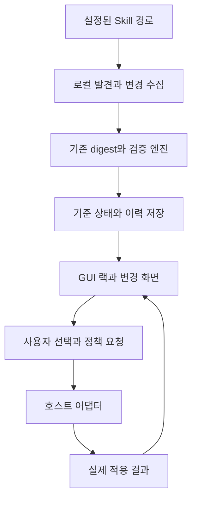

# mago-ski GUI 제품 설계와 구현 계획

작성일: 2026년 10월 26일 KST  
문서 버전: 1.0  
문서 목적: GUI의 존재 이유, 장기 제품 경험, 설계 원칙, 단계별 구현 범위와 검증 기준을 함께 정의한다.  
대상 독자: 제품 기획자, 디자이너, mago-ski 및 호스트 연동 개발자, 초기 사용자 테스트 담당자

이 문서의 중심 기준은 다음과 같다.

> 사용자가 가져야 할 느낌은 “보안 도구를 운영하고 있다”보다 “내 Skill들이 어떻게 바뀌는지 이제 편하게 알 수 있다”에 가까워야 한다.

우리는 사용자가 평소처럼 Skill을 설치하고 사용하는 흐름을 유지하면서, 설치된 상태를 기억하고 이후의 변화를 이해하고 처리하도록 돕는 GUI를 만든다. VST와 하드웨어 장비에서 가져오는 시각적 개성은 제품에 관심을 갖게 하는 수단이다. 제품을 계속 사용하는 이유는 자동 발견, 이해하기 쉬운 변경 확인, 적은 조작, 정확한 적용 상태, 필요한 순간의 선택지에서 만들어야 한다.

이 계획은 실행 가능한 초기 제품과 장기적인 보안 랙의 방향을 함께 다룬다. 장기 기능을 첫 출시의 전제 조건으로 삼지 않는다. 현재 mago-ski가 제공하는 기능, 논의에서 확정한 방향, 이 문서의 제안, 추가 검증이 필요한 가설을 구분한다.

## 목차

1. [문서의 판단 기준과 구현 기준선](#section-01)
2. [새로운 GUI를 만드는 이유](#section-02)
3. [GUI의 역할과 최종적으로 달성할 과제](#section-03)
4. [대상 사용자와 해결할 상황](#section-04)
5. [변하지 않아야 할 설계 원칙](#section-05)
6. [장기적으로 원하는 사용 경험](#section-06)
7. [화면 구조와 정보 구조](#section-07)
8. [VST 시각 언어와 조작 규칙](#section-08)
9. [상태 모델과 전역 정책](#section-09)
10. [사이드체인과 자동 동작](#section-10)
11. [시스템 아키텍처와 호스트 연동](#section-11)
12. [데이터와 변경 처리 설계](#section-12)
13. [신뢰와 승인과 개인정보의 경계](#section-13)
14. [단계별 제품 범위](#section-14)
15. [PoC 상세 실행 계획](#section-15)
16. [GUI v0.1 상세 제품 요구사항](#section-16)
17. [GUI v0.2와 이후 확장](#section-17)
18. [개발 작업 목록과 의존 관계](#section-18)
19. [검증과 테스트 계획](#section-19)
20. [성공 지표와 사용자 연구](#section-20)
21. [데모와 마케팅과 사용자 모집](#section-21)
22. [위험과 제품 범위 관리](#section-22)
23. [결정 기록과 미결정 사항](#section-23)
24. [최종 완료 기준](#section-24)
25. [용어와 근거 자료](#section-25)

<a id="section-01"></a>

## 1 문서의 판단 기준과 구현 기준선

### 1.1 논의에서 확인한 방향

- 사용자의 편리성이 가장 우선이다.
- Skill 공급망 보안의 시급성을 사용자가 먼저 이해해야만 도입할 수 있는 제품으로 만들지 않는다.
- 사용자가 Skill을 직접 만들었거나 수정할 수 있다고 가정하지 않는다.
- Skill별 제어 명세 작성, 보안 파이프라인 설계, 키와 인증서의 수동 연결을 일반 사용자의 첫 사용 조건으로 요구하지 않는다.
- 기존 Skill 설치 방식과 사용 흐름을 가능한 한 유지한다.
- 전역 정책과 자동 구성으로 기본 동작을 제공한다.
- VST와 랙 장비의 외형, 상태 램프, 미터, 스위치, 노브를 제품의 고유한 시각 언어로 활용한다.
- 직접 케이블을 연결하는 편집기는 기본 사용 경험을 완성한 뒤 고급 기능으로 검토한다.
- 변화가 없을 때 신경 쓰지 않아도 되는 경험까지 편리성에 포함한다.

### 1.2 이 문서에서 제안하는 초기 제품 결정

다음은 구현을 시작하기 위한 제안이다. 사용자 연구와 기술 검증으로 수정할 수 있다.

- 첫 실제 호스트 연동은 현재 mago-ski의 지원 기반이 있는 Pi를 대상으로 한다.
- 초기 검증 플랫폼은 Linux 또는 macOS 중 개발 환경에서 재현 가능한 하나를 먼저 고른다. 다른 플랫폼은 별도 검증 후 지원으로 표시한다.
- 개인용 첫 사용은 관찰과 상태 기록만으로 완료할 수 있게 한다. PKI 설정을 필수로 만들지 않는다.
- GUI v0.1은 자동 발견, 상태 기록, 변경 비교, 이력, 정확한 연결 상태, 기존 PKI 연동의 가시성을 중심으로 한다.
- 전체 파일 복원, 개인용 신규 서명 체계, 자유로운 캔버스, 권한 샌드박스는 별도 출구 조건을 충족한 뒤 확장한다.
- 기존 조직 정책은 개인용 관찰 설정으로 약화하거나 덮어쓰지 않는다.

### 1.3 현재 엔진 기준선

기준 저장소는 [mago-foundation/mago-ski](https://github.com/mago-foundation/mago-ski)이며, 대화에서 확인한 코드 기준은 커밋 `2edea6cfeb4bc00ed6716bbe61328569ad14fb65`이다. 구현 착수 시점에는 변경된 코드와 차이를 확인한다.

| 항목 | 확인한 현재 동작 | GUI 계획에 주는 의미 |
| --- | --- | --- |
| 승인 단위 | 파일 내용과 POSIX 실행 비트를 포함한 정확한 Skill tree digest | GUI가 해시 판정 강도를 임의로 완화하지 않는다 |
| 신뢰 구조 | Root가 승인자를 위임하고 승인자는 특정 버전을 서명 | 승인과 단순 상태 기록을 구분한다 |
| 검증 결과 | VERIFIED, UNAPPROVED_CHANGE, NO_CERTIFICATE, UNTRUSTED_SIGNER, REVOKED, EXPIRED, UNVERIFIABLE | 현재 결과를 정체불명의 안전 점수로 바꾸지 않는다 |
| 호스트 | Pi 확장, GitHub Actions, CLI | 모든 에이전트에 작동한다고 표시하지 않는다 |
| 정책 모드 | shadow와 enforce | 관찰 여부와 실제 집행 모드를 함께 보여준다 |
| 정책 로딩 | 확인한 Pi 코드에서는 정책을 한 번 로드하여 유지 | 실시간 설정에는 명시적 재적용과 확인 경로가 필요하다 |
| 변경 비교 | 두 디렉터리의 파일, Markdown 섹션, 실행 비트, HTTP(S) origin 변화 | 보관된 기준 내용이 있어야 풍부한 비교를 할 수 있다 |
| 복원 | 전체 버전 보관과 원클릭 복원은 별도 개발 대상 | digest만으로 복원 가능하다고 약속하지 않는다 |
| 실행 제어 범위 | 지원되는 Pi 로딩과 도구 경로에 한정된 집행 | 전체 프로세스 샌드박스와 구분한다 |
| 플랫폼 | 엔진 0.1은 Linux와 macOS 지원, Windows 미지원 | GUI가 Windows에서 열려도 검증 지원으로 오해하게 하지 않는다 |

현재 mago-ski의 핵심 질문은 “이 버전을 조직이 승인했으며 그 승인이 지금도 유효한가”이다. GUI의 개인용 변화 관찰 기능은 그 위에 추가되는 사용 경험이며, 조직 승인의 의미를 바꾸지 않는다.

### 1.4 버전 명명

이 문서의 PoC, GUI v0.1, GUI v0.2는 GUI 제품의 개발 단계다. 기존 mago-ski 엔진 0.1과 동일한 버전 체계라고 가정하지 않는다. 릴리스에서는 GUI 버전, 엔진 버전, 호스트 어댑터 버전을 각각 확인할 수 있어야 한다.

<a id="section-02"></a>

## 2 새로운 GUI를 만드는 이유

### 2.1 해결하려는 도입 병목

제품 기획의 출발 가설은 개인 사용자가 Skill 공급망 보안을 설치 전의 시급한 과제로 여기지 않는다는 것이다. 이는 대화에서 제시한 사용자 관찰이자 검증할 사업 가설이며, 전체 시장에 대한 입증된 통계는 아니다.

이 상황에서 PKI의 기술적 필요성만 설명하면 사용자가 먼저 학습과 설정 비용을 지불해야 한다. 현재 CLI 흐름은 정책 파일, 경로, 키, Root, 승인자, 인증서, 만료, 철회를 연결하는 지식을 요구한다. 그 과정에서 얻는 이점은 문제가 생기기 전에는 눈에 잘 보이지 않는다.

GUI는 이 비용을 줄여야 한다. 명령을 버튼으로 하나씩 옮기는 것만으로는 부족하다. 사용자의 목적을 기준으로 여러 명령과 상태 확인을 하나의 흐름으로 묶어야 한다.

### 2.2 사용자가 먼저 얻어야 하는 효용

사용자는 다음 사실을 어렵지 않게 파악할 수 있어야 한다.

- 어떤 Skill이 어디에 설치돼 있는가.
- 언제 처음 발견했고 어떤 상태를 기준으로 기억하고 있는가.
- 이후 어느 파일과 문장이 바뀌었는가.
- 새 실행 파일이나 네트워크 origin 같은 구체적인 변화가 있었는가.
- 해당 변화는 단순히 기록됐는가, 승인이 필요한가, 현재 호스트에서 보류 또는 차단됐는가.
- 자신이 지금 선택할 수 있는 행동은 무엇인가.

이 효용은 Skill을 직접 개발하지 않는 사용자에게도 제공할 수 있어야 한다.

### 2.3 시각적 개성이 필요한 이유

VST 스타일은 제품의 첫 인상과 데모를 차별화하는 디자인 가설이다. 파일 상태의 변화와 개입 결과를 장치의 반응처럼 표현하면 짧은 영상에서도 동작을 전달할 수 있다.

그러나 노브 수, 애니메이션 양, 케이블 수는 제품 성과 지표가 아니다. 시각적 개성 때문에 정보를 읽기 어렵거나 조작이 늘어나면 디자인을 수정한다. 화제성이 지속 사용으로 이어지는지는 별도 측정한다.

### 2.4 프로젝트가 실패한 것으로 볼 상황

다음 중 하나라도 지속된다면 시각적 완성도와 관계없이 방향을 재검토한다.

- GUI를 설치했지만 첫 상태 확인까지 CLI 문서를 따라야 한다.
- 사용자가 새 Skill을 쓰기 전에 명세나 연결 그래프를 작성해야 한다.
- 사용자가 화면의 녹색 상태를 “악성 아님이 검증됨”으로 이해한다.
- 노브를 돌려도 실제 적용 여부를 알 수 없다.
- 알림이 많아 사용자가 제품 전체를 끈다.
- 제품을 닫으면 무엇이 계속 동작하는지 알 수 없다.
- 단순한 변경을 처리하기 위해 원래 작업보다 더 많은 조작이 필요하다.

<a id="section-03"></a>

## 3 GUI의 역할과 최종적으로 달성할 과제

### 3.1 제품의 중심 역할

GUI는 설치된 Skill의 상태와 변화를 사용자의 판단과 행동으로 연결한다. 이를 위해 발견, 기억, 비교, 설명, 선택, 적용 확인을 하나의 경험으로 묶는다.

일상적인 화면에서는 구현 상세를 숨기되, 사용자가 근거를 확인하고 싶을 때 원문 diff, digest, 승인자, 만료일, 적용 정책을 확인할 수 있게 한다. 쉬운 설명이 근거를 대체해서는 안 된다.

### 3.2 최종적으로 달성할 다섯 과제

| 과제 | 사용자가 얻는 결과 | 달성 여부를 확인하는 방법 |
| --- | --- | --- |
| 도입 마찰 감소 | 평소 설치 흐름을 유지하며 시작 | 첫 사용 소요 시간과 수동 설정 수 |
| 변화의 가시성 | 바뀐 부분을 직접 이해 | 변경 식별 과제의 정답과 소요 시간 |
| 처리의 단순화 | 다음 행동을 선택하고 결과 확인 | 사건 처리 완료율과 조작 수 |
| 정확한 통제감 | 관찰과 실제 집행 범위를 구분 | 모드와 집행 상태 이해도 |
| 지속 가능한 사용 | 변화가 없을 때 신경 쓰지 않아도 됨 | 알림 해제율과 지속 사용 및 불편 보고 |

### 3.3 장기 제품의 모습

장기적으로 GUI는 자동 구성된 랙에서 Skill 버전 검증, 변화 관찰, 실행 정책, 응답 필터링을 함께 보여줄 수 있다. mago-ski는 승인 버전의 근거를 제공하고, CLEAR는 연동된 실행 경계에서 의도와 행동 및 응답을 평가한다.

각 모듈은 독립적으로 기능과 한계를 설명해야 한다. 모듈이 많아져도 기본 사용자는 프리셋과 필요한 순간의 선택만으로 작업할 수 있어야 한다. 새 모듈이 기존 사용자의 초기 설정을 증가시키지 않도록 한다.

### 3.4 이번 제품의 비목표

- GUI 첫 출시에서 범용 에이전트 호스트를 새로 만들지 않는다.
- 임의의 Skill을 안전하다고 자동 인증하는 기능을 약속하지 않는다.
- 모든 파일 접근과 네트워크 전송 및 시스템 콜을 현재 엔진만으로 통제한다고 주장하지 않는다.
- Skill 제작자에게 새로운 명세 작성을 요구하지 않는다.
- 일반 사용자에게 PKI 체계 설계나 정책 그래프 편집을 요구하지 않는다.
- 화제성을 이유로 측정 근거 없는 신뢰 점수나 허구의 실시간 파형을 만들지 않는다.

<a id="section-04"></a>

## 4 대상 사용자와 해결할 상황

### 4.1 우선 대상

첫 대상은 지원 호스트에서 제삼자 Skill을 설치하고 사용하는 개인 개발자와 숙련 사용자다. 보안 엔지니어가 아니어도 사용할 수 있어야 한다. 다만 실제 지원 호스트와 플랫폼의 범위는 분명하게 표시한다.

조직의 PKI 관리자와 세밀한 자동화 규칙을 설계하는 전문가는 확장 대상이다. 이들의 요구가 개인 사용자의 기본 화면을 복잡하게 만들지 않도록 상세 기능으로 분리한다.

### 4.2 대표 사용 상황

| 상황 | 사용자의 질문 | 제품이 제공할 결과 |
| --- | --- | --- |
| 설치 후 상태 확인 | 내가 쓰는 Skill이 무엇이지 | 실제 경로와 호스트가 연결된 목록 |
| 조용한 업데이트 | 어제 쓰던 것과 무엇이 달라졌지 | 기준 상태와 현재 상태의 비교 |
| 여러 파일 변경 | 무엇부터 봐야 하지 | 파일과 섹션별 변화 요약 및 원문 |
| 변경 수용 | 이 상태를 계속 사용하고 싶어 | 기준 갱신 또는 권한에 따른 승인 |
| 기존 보호 동작 | 왜 이 Skill을 못 쓰지 | 실제 검증 사유와 필요한 처리 |
| 연결 장애 | 화면이 조용한데 검사는 하고 있나 | 연결 상태와 마지막 성공 확인 시각 |
| 초기 탐색 | 명령과 정책을 배우지 않고 써보고 싶어 | 관찰 모드로 완료되는 시작 경험 |

### 4.3 사용자가 새로 하지 않아야 할 일

Skill별 설명 파일 작성, 보안 태그 입력, 수동 digest 계산, 파일 변경마다 명령 실행, 호스트 연결선 편집은 기본 워크플로우에 포함하지 않는다. 자동 발견을 신뢰하기 어려운 경로만 선택적으로 추가하도록 한다.

<a id="section-05"></a>

## 5 변하지 않아야 할 설계 원칙

### 5.1 기존 작업 흐름 유지

사용자는 기존 도구로 Skill을 설치할 수 있어야 한다. GUI 전용 설치 경로는 편의를 위한 추가 선택지가 될 수 있지만 기본 보호를 받기 위한 필수 경로로 삼지 않는다. 새 Skill은 발견 후 전역 정책에 따라 처리한다.

### 5.2 기본 동작은 자동 구성

호스트와 Skill 경로를 가능한 범위에서 자동 발견한다. 사용자가 확인해야 할 것은 발견 결과와 실제 접근 범위다. 기본 랙과 모듈 연결은 제품이 만든다.

### 5.3 변화 없는 시간도 설계

일상적인 검사 성공을 반복 알림으로 보내지 않는다. 지속적인 운영이 필요하면 사용자가 창을 닫았을 때 관찰 서비스가 계속 실행되는지 명확히 표시한다. 조용한 상태와 관측 불능 상태를 구분한다.

### 5.4 사실과 해석 구분

파일 변경, 실행 비트 변화, origin 추가는 확인된 사실로 표시한다. “외부 전송 의도가 있다” 같은 문장은 분석 결과 또는 추론으로 표시하고 근거를 연결한다. 악성 여부를 판단하지 않은 상태에서 안전 또는 위험 확정으로 표현하지 않는다.

### 5.5 기록과 승인 구분

최초 상태 기록, 사용자의 변경 확인, 로컬 서명, 조직 승인은 서로 다른 의미다. 화면에서 같은 초록색 체크나 같은 문구로 합치지 않는다. 조직 승인은 기존 검증 체계가 실제로 유효성을 확인한 경우에만 표시한다.

### 5.6 설정과 적용 상태 구분

사용자가 선택한 값은 요청한 설정이다. 호스트가 적용을 확인한 값만 실제 적용 상태다. 적용 대기, 실패, 재시작 필요를 표시한다. UI의 움직임만으로 집행이 변경됐다고 표현하지 않는다.

### 5.7 시각 언어와 동작 의미의 일치

연속값은 노브나 페이더, 이산 정책은 단계 선택기, 즉시 행동은 버튼, 결과는 미터와 상태 램프로 표현한다. 정밀한 수치에는 직접 입력과 키보드 조작을 제공한다.

### 5.8 기본 경험과 고급 편집의 분리

기본 사용자는 랙만으로 제품의 효용을 얻는다. 정책 JSON, 키, 인증서, 그래프, 상세 판정은 필요할 때 열 수 있다. 고급 기능의 존재가 기본 흐름의 완료를 막아서는 안 된다.

### 5.9 연동 범위를 숨기지 않기

관찰만 하는지, 로딩을 제어하는지, 특정 도구를 가로채는지, 별도 실행 격리가 있는지 구분한다. 연결되지 않은 기능을 작동하는 노브로 보여주지 않는다.

### 5.10 한 번의 행동은 명확한 대상을 가짐

기준 갱신과 승인은 사용자가 확인한 특정 digest에 적용한다. 다른 창이나 백그라운드 업데이트가 파일을 바꾸면 다시 확인하도록 한다. 전체 모드 변경과 Skill 한 개의 처리를 명확히 구분한다.

<a id="section-06"></a>

## 6 장기적으로 원하는 사용 경험

### 6.1 첫 실행

사용자가 앱을 열면 지원 호스트와 설치된 Skill을 발견한다. 사용자는 발견한 경로를 확인하고 기본 관찰 정책을 선택한다. 첫 실행 완료 전에 PKI 키나 명세를 만들 필요가 없다.

제품은 최초 발견 상태를 기록한다는 의미를 짧게 설명한다. 이 상태가 안전 검증 결과가 아니라 비교를 위한 출발점임을 함께 알린다. 관찰된 Skill 수와 마지막 확인 시각을 보여주면 첫 사용을 완료한다.

기존 Enforce 정책이 있는 호스트를 발견하면 그 상태를 그대로 표시한다. GUI의 관찰 시작이 기존 호스트 집행을 해제하지 않는다.

### 6.2 평소 사용

사용자는 평소처럼 에이전트와 Skill을 사용한다. 필요할 때만 패널을 연다. 패널은 연결 상태, 확인이 필요한 변화, 실제 적용 정책을 보여준다. 검사 성공 이력 전체는 상세 화면에 보관하되 메인 화면을 가득 채우지 않는다.

### 6.3 새 Skill 설치

사용자가 기존 설치 도구로 새 Skill을 설치하면 GUI가 발견한다. 설정된 경로 범위에서 최초 상태를 기록하고 새로 발견했음을 표시한다. 기본 개인용 관찰 흐름에서는 별도 승인 대화상자로 작업을 중단하지 않는다.

자동 기록이 불가능하거나 검증할 수 없는 파일 구조라면 그 사실을 표시한다. 표시되지 않은 채 사라지거나 검사가 완료된 것처럼 처리하지 않는다.

### 6.4 사용 중 변경 발견

완료된 변경 묶음을 확인한 뒤 알림을 한 번 제공한다. 알림에는 Skill 이름, 변한 항목의 범주, 다음 선택지를 담는다. 파일 저장 이벤트마다 알림을 보내지 않는다.

사용자는 변경 화면에서 파일 추가와 삭제, 문장 변경, 실행 비트, origin 변화 등을 확인한다. 분석이 불완전한 경우 한계를 표시한다. 원문 전체가 필요하면 펼쳐 볼 수 있다.

### 6.5 변화 처리

관찰 모드에서는 “변경 확인 완료” 또는 “현재 상태를 비교 기준으로 기록” 같은 의미가 정확한 행동을 제공한다. PKI가 구성된 환경에서는 승인 권한과 서명 대상을 확인한 뒤 “이 버전 승인”을 제공한다.

호스트가 이미 보류한 경우에는 단순 확인과 실제 사용 재개를 구분한다. 사용 재개는 해당 집행 정책이 충족되고 호스트가 결과를 확인했을 때 완료된다.

### 6.6 문제 발견과 복원

장기적으로 사용자는 보관된 이전 버전을 선택해 복원할 수 있다. 복원 전 현재 상태를 보존하고, 덮어쓸 파일과 제외된 파일을 보여준다. 활성 세션의 재로딩 여부를 안내한다.

복원은 보관한 범위의 파일 상태를 되돌리는 동작이다. 이미 실행한 외부 행동, 유출된 정보, 이미 모델 컨텍스트에 들어간 내용, 외부 의존성의 상태까지 되돌린다고 설명하지 않는다.

### 6.7 여러 보안 모듈을 사용하는 시점

사용자가 CLEAR나 Limiter를 추가하면 지원 연동이 제공하는 모듈이 자동으로 랙에 추가된다. 각 모듈은 무엇을 관측하고 어디서 개입하는지 표시한다. 사용자는 기본 프리셋을 선택한 뒤 그대로 쓸 수 있어야 한다.

직접 노드를 연결하는 고급 사용자는 추가 규칙을 만들 수 있다. 기본 사용자의 설치와 일상 작업은 그 기능을 배우지 않아도 완료된다.

<a id="section-07"></a>

## 7 화면 구조와 정보 구조

### 7.1 기본 화면

메인 화면은 작은 랙과 현재 처리할 항목을 중심으로 한다. 화면의 첫 영역에서 세 질문에 답해야 한다. 연결돼 있는가, 무엇이 달라졌는가, 내가 할 일이 있는가.

| 영역 | 필수 정보 | 주요 행동 |
| --- | --- | --- |
| 연결과 범위 | 호스트, 플랫폼, 관찰 경로, 마지막 성공 확인 | 연결 진단과 경로 수정 |
| 기본 랙 | 실제로 사용 가능한 모듈, 모드, 적용 상태 | 프리셋 선택과 상세 열기 |
| Skill 목록 | 이름, 설치 위치 구분, 변화 상태, 승인 상태 | Skill 상세 열기 |
| 확인 필요 항목 | 미처리 변경, 만료, 실제 차단 사유 | 해당 문제 처리 |
| 최근 사건 | 최근의 의미 있는 변화와 처리 결과 | 이력 상세 보기 |

처음부터 모든 로그와 성능 수치를 표시하지 않는다. 비용과 추론 수치 등 연결되지 않은 지표를 공간을 채우기 위해 추가하지 않는다.

### 7.2 Skill 상세 화면

설치 인스턴스, 현재 digest, 비교 기준, 파일 변경 목록, 확인 이력, 인증서 정보, 호스트 적용 결과를 제공한다. 이름이 같은 Skill이 다른 경로에 있으면 별도 인스턴스로 구분한다.

현재 상태와 과거 상태가 어느 시점의 것인지 표시한다. 예전 비교 결과를 최신 상태로 오해하게 하지 않는다. 새 변경이 발생하면 해당 diff가 오래됐음을 표시한다.

### 7.3 변경 화면

첫 화면에는 짧은 사실 요약과 파일 목록을 보여준다. 파일 또는 섹션을 선택하면 원문 diff가 열린다. 자동 분석은 원문에 연결되고, 분석 범위를 벗어난 파일은 생략 사유를 남긴다.

확인 행동에는 비교한 버전의 digest를 결합한다. 사용자가 읽는 동안 파일이 바뀌면 확인과 승인 버튼을 재평가하고 최신 비교를 제안한다.

### 7.4 전역 설정 화면

새 Skill 처리, 변경 알림, 지원되는 변경 시 보류, 보관 정책, 알림 빈도, 관찰 경로를 조정한다. 정책은 호스트별 예외가 생기기 전까지 전역 기본값을 우선한다.

설정 화면은 선택 가능한 항목과 지원되지 않는 항목을 구분한다. 지원되지 않는 옵션을 켜는 것처럼 보이게 만들지 않는다.

### 7.5 고급 화면

PKI Root와 승인자, 인증서와 철회, 원시 로그, 정책 내보내기, 향후 모듈 연결 그래프를 다룬다. 일반 사용자의 첫 실행에는 노출하지 않아도 된다.

<a id="section-08"></a>

## 8 VST 시각 언어와 조작 규칙

### 8.1 디자인 방향

참고 이미지는 ViatorDSP BedroomComp이며, 중앙 미터, 기능별 구획, 큰 노브, 상태 버튼의 구성을 참고한다. 브랜드, 로고, 고유 자산을 그대로 복제하지 않는다. 과도한 질감과 장식 때문에 읽기와 조작이 어려워지면 간결하게 조정한다.

### 8.2 조작과 실제 기능의 대응

| 조작 | 적합한 값 | 초기 적용 |
| --- | --- | --- |
| 단계 선택 노브 | 관찰, 변경 확인, 승인 필수와 같은 이산 정책 | 지원 동작과 범위를 설명한 전역 모드 |
| 연속 노브 | 보관 일수나 향후 검토 예산처럼 단위가 있는 값 | 상세 설정에서 필요할 때 사용 |
| 토글 | 자동 보관, 알림 활성화 | 현재 상태와 적용 결과 표시 |
| 버튼 | 변경 보기, 기준 기록, 승인, 재확인 | 한 행동과 한 대상을 연결 |
| 램프 | 새 발견, 변경, 만료, 철회, 확인 필요 | 색과 텍스트를 함께 사용 |
| 미터 | 실제 검사 사건과 처리 결과 | 입력이 발생했을 때만 반응 |
| 케이블 | 모듈 사이의 관찰 상태와 동작 연결 | 초기에는 자동 구성된 연결을 읽기 전용으로 표시 가능 |

### 8.3 도입하지 않을 가짜 연속값

Hash Strictness 50%, 파일 읽기 권한 0.5, 의미가 정의되지 않은 신뢰도 85%, 근거 없는 Injection Q-Factor는 노출하지 않는다. 파일 읽기는 허용 경로와 작업 집합으로 표현하고, 필요하면 단계 선택기에 사람이 읽는 이름을 붙인다.

### 8.4 미터의 진실성

검사 사건 수, 검사 중 상태, 변경 발견 수, 실제 차단 수는 서로 다른 지표다. 무엇을 보여주는지 미터에 이름과 시간 구간을 표시한다. 차단 비율을 표시할 경우 분모가 되는 관측 사건도 확인할 수 있게 한다.

아무 사건도 없을 때 파형을 임의로 움직이지 않는다. 입력 없음, 관찰 중, 연결 끊김, 확인 실패를 서로 다른 상태로 보여준다. 실제 시스템 콜 수집이 없으면 시스템 콜 스펙트럼을 그리지 않는다.

### 8.5 자동 제어의 표시

장기적으로 노브가 자동 조절되는 경우 기본 설정과 현재 적용값을 함께 표시한다. 자동 조절의 원인, 발생 시각, 종료 조건을 열어볼 수 있어야 한다. 사용자가 돌린 값을 자동 제어가 조용히 덮어쓰지 않는다.

### 8.6 접근성과 입력

모든 중요 행동은 텍스트, 키보드, 보조기기로 사용할 수 있어야 한다. 노브는 드래그 외에 키보드 조작과 정확한 값 입력 또는 단계 선택을 제공한다. 색만으로 상태를 구분하지 않는다. 움직임 줄이기를 지원한다.

기본 조작은 일반적인 창 크기와 확대 상태에서 잘려서는 안 된다. 작은 화면에서는 랙을 쌓아 배치한다. 오디오 장비에 익숙하지 않은 사용자도 레이블을 읽고 목적을 이해해야 한다.

<a id="section-09"></a>

## 9 상태 모델과 전역 정책

### 9.1 독립적으로 보관할 상태 축

상태 하나로 모든 의미를 합치지 않는다.

| 상태 축 | 예시 | 의미 |
| --- | --- | --- |
| 관찰 상태 | 최초 발견, 기준 기록됨, 변경됨, 읽기 실패 | 이전에 기억한 상태와의 관계 |
| PKI 상태 | VERIFIED, NO_CERTIFICATE, REVOKED 등 | 기존 엔진의 승인 검증 결과 |
| 처리 상태 | 미확인, 확인 완료, 승인 대기 | 사용자의 처리 진행 |
| 적용 상태 | 적용됨, 적용 대기, 재시작 필요, 실패 | 호스트에 반영됐는지 여부 |
| 연결 상태 | 연결됨, 재연결 중, 끊김 | 현재 관측과 명령 전달의 가능 여부 |

예를 들어 “변경 확인 완료”이면서 “NO_CERTIFICATE”일 수 있다. 이 조합을 오류로 보거나 자동으로 VERIFIED로 바꾸지 않는다.

### 9.2 제안하는 전역 기본값

| 설정 | GUI v0.1 제안 | 조건 |
| --- | --- | --- |
| 새 Skill | 바로 사용하며 최초 상태 기록 | 기존 호스트 정책이 사용을 금지하면 그 정책 우선 |
| 내용 변경 | 변경 묶음 단위 알림 | 관찰 모드는 실행을 차단하지 않음 |
| 비교용 보관 | 저장 범위와 위치를 설명하고 활성화 | 용량, 보관 제외, 완전성 표시 |
| 외부 전송 | 제품이 별도 전송하지 않는 로컬 처리 | 선택적 분석 기능은 별도 동의 |
| 반복 검사 성공 | 알림 생략 | 이력에서 확인 가능 |
| 정책 변경 | 적용 확인 후 완료 표시 | 재로딩이 필요하면 명시 |

보관 기능의 기본 활성화 여부와 보관 용량은 PoC에서 비용과 개인정보 기대를 확인한 뒤 확정한다. 이 표는 초기 제안이며 확정된 사용자 선호라고 기록하지 않는다.

### 9.3 단계 선택기와 집행의 관계

장기적인 단계 선택기는 다음 세 경험을 제공할 수 있다.

- 관찰: 변화를 기록하고 알려준다.
- 변경 확인: 기록한 기준에서 달라진 Skill의 다음 로딩을 확인 전까지 보류한다.
- 승인 필수: 유효한 PKI 승인 버전만 지원 호스트에서 사용한다.

관찰은 GUI v0.1의 기본 흐름이다. 변경 확인 단계의 실제 로딩 보류는 새 호스트 기능이며 구현 전에는 선택할 수 없게 한다. 승인 필수는 기존 Enforce 정책이 실제로 구성된 호스트에서만 사용 가능하다. 단계가 연속적인 안전 점수라고 설명하지 않는다.

### 9.4 정책 우선순위

조직이 관리하는 집행 정책을 최상위 제약으로 유지한다. 그 안에서 호스트별 지원 범위와 개인 설정을 적용한다. 사용자 설정이 조직 정책과 충돌하면 충돌과 최종 적용값을 표시한다.

기존 Enforce를 GUI의 관찰 모드로 전환하는 행동은 단순한 개인용 화면 설정과 구분한다. 권한과 실제 정책 변경이 필요한 별도 행동으로 다룬다.

<a id="section-10"></a>

## 10 사이드체인과 자동 동작

### 10.1 제품에서의 의미

사이드체인은 관측한 상태를 다른 보호 동작에 연결하는 규칙이다. 사용자에게 케이블 편집을 요구하지 않아도 기본 프리셋 안에서 동작할 수 있다. 초기에는 수치 신뢰도보다 사실 기반 상태를 입력으로 사용한다.

### 10.2 초기와 장기 연결

| 입력 | 동작 | 단계 |
| --- | --- | --- |
| 최초 발견 | 기준 기록과 새 발견 표시 | PoC 및 v0.1 |
| digest 변경 | 변경 표시와 묶음 알림 | PoC 및 v0.1 |
| PKI 만료와 철회 | 실제 검증 결과와 집행 사유 표시 | 기존 연동을 활용하는 v0.1 |
| 미확인 변경 | 다음 Skill 로딩 보류 | v0.2 후보 |
| 미확인 변경 | 세션의 외부 전송에 확인 요구 | 별도 실행 경계가 있는 장기 연동 |
| CLEAR 판단 불확실 | 추가 검토 또는 사람 확인 | CLEAR 연동 단계 |
| 실행 예산 소진 | 추가 실행 중단 | Limiter 연동 단계 |

### 10.3 규칙의 안전한 의미

자동 규칙은 적용 시점과 종료 조건을 가져야 한다. 변경이 발견됐다는 사실만으로 그 Skill이 악성이라고 판정하지 않는다. 철회와 신규 발견도 같은 점수로 합치지 않는다.

조직의 금지 규칙과 필수 검증은 사이드체인이 완화하지 못한다. 자동으로 추가한 제한을 해제하는 조건도 명시한다. 규칙이 서로 반복 실행되거나 정책 진동을 일으키지 않도록 규칙 수, 이벤트 재진입, 우선순위를 제한한다.

### 10.4 고급 캔버스의 조건

캔버스는 기본 프리셋으로 해결되지 않는 반복 요청이 확인된 뒤 도입한다. 연결 가능한 포트는 입력과 출력의 자료형, 단위, 적용 범위를 명시한다. 문자열 상태와 확률, 단순 횟수를 같은 신호로 취급하지 않는다.

보안상 필수인 집행 순서는 자유롭게 재배치하지 못하게 한다. 출력 필터를 뒤에 연결했다고 이미 실행된 전송을 취소할 수는 없다. 미리 검증하는 실행 경계와 반환 데이터를 가공하는 경계를 별도로 표현한다.

<a id="section-11"></a>

## 11 시스템 아키텍처와 호스트 연동

### 11.1 구성 요소

로컬 GUI와 관찰 서비스를 분리하는 구조를 기본 후보로 삼는다. 창을 닫아도 서비스를 계속 실행할지는 사용자가 선택하고 상태를 확인할 수 있어야 한다. 구체적인 패키징 프레임워크는 PoC 결과로 결정한다.

| 구성 요소 | 책임 | 경계 |
| --- | --- | --- |
| GUI | 랙, 변경 화면, 설정, 사용자 행동 | 자체적으로 승인 결과를 만들어내지 않음 |
| 로컬 서비스 | 발견, 검사 일정, 이벤트 통합, 작업 실행 | 선택된 경로와 기능만 접근 |
| 엔진 어댑터 | 기존 digest와 verify 및 diff 재사용 | 기존 포맷과 검증 의미 유지 |
| 기록 저장소 | 인스턴스, 기준 상태, 사건, 선택적 파일 보관 | 인증서와 독립된 제품 상태 |
| 정책 계층 | 개인 설정과 기존 정책의 최종 결과 계산 | 개인 설정으로 조직 제약 완화 금지 |
| 호스트 어댑터 | 실제 지원 범위 조회, 로딩 제어, 적용 확인 | 지원하지 않는 작업 명시 |
| 향후 CLEAR 어댑터 | 지원 실행 경계의 판단과 필터 결과 | 로컬 버전 기록과 별도 의미 |

### 11.2 기본 데이터 흐름



이 그림은 관찰과 명령의 흐름을 설명한다. 모든 파일 접근이 이 서비스 안으로 강제 통과한다는 보안 경계 그림은 아니다.

### 11.3 기존 엔진 재사용

가능한 범위에서 TypeScript 함수 또는 구조화된 결과를 반환하는 CLI를 감싸는 방식으로 시작한다. 구현 중 어느 경로를 택하든 GUI가 별도의 tree digest 규칙을 구현하지 않도록 한다.

CLI를 사용할 때는 명령 문자열을 조합하지 않고 인자 배열로 실행한다. 경로와 이름 및 reason을 셸 코드로 해석하지 않는다. 구조화된 stdout, 종료 코드, stderr를 분리하고 입력 오류와 검증 실패를 구분한다.

기존 정책 파서는 허용하지 않은 필드를 거부한다. GUI용 chain, sidechain, preset 스키마를 현재 policy.json에 그대로 넣지 않는다. GUI 상태 포맷을 별도로 두고 지원되는 엔진 필드로 변환한다. 엔진 정책 확장이 필요하면 별도 버전과 호환성 규칙을 정의한다.

### 11.4 호스트 기능 협상

GUI는 연결된 호스트가 지원하는 기능을 조회하거나 어댑터가 검증한 기능 목록을 사용한다. 예를 들어 관찰, 검증 결과 제공, 정책 재로딩, 다음 Skill 로딩 보류, 승인 후 재검증, 실행 예산 제어를 각각 구분한다.

지원 여부는 기능별로 기록한다. 앱이 연결됐다는 이유만으로 모든 모듈의 집행 기능을 켜지 않는다. 구현하지 않은 기능은 숨기거나 지원되지 않는 이유와 함께 비활성화한다.

### 11.5 정책 적용 프로토콜

장기적인 실시간 정책 변경은 다음 절차를 따른다.

1. GUI가 변경 요청과 고유 요청 ID를 만든다.
2. 서비스가 스키마, 권한, 상위 제약, 호스트 지원 여부를 검증한다.
3. 정책 스냅샷과 단조 증가하는 로컬 정책 revision을 만든다.
4. 호스트가 적용하거나 재시작 필요와 실패를 반환한다.
5. GUI가 요청값과 실제 적용 revision을 나란히 보관한다.
6. 이후 사건에 실제 적용 revision을 연결한다.

파일을 쓴 것만으로 적용 완료로 표시하지 않는다. 현재 Pi 확장의 정책 일회 로딩 특성을 반영해, 재로딩 경로를 구현하기 전에는 재시작 필요로 표시한다.

### 11.6 적용 경계

설정 변경은 다음 지원되는 체크포인트부터 적용한다. 이미 실행한 행동을 취소하거나 모델이 읽은 내용을 회수한다고 표현하지 않는다. Skill을 목록에서 제거해도 이전 대화 컨텍스트에 들어간 지침은 남을 수 있다. 필요한 경우 새 세션 시작을 제안한다.

GUI가 다음 로딩을 보류할 수 있는지와 현재 진행 중인 실행을 중단할 수 있는지를 별도 기능으로 취급한다. 중단을 지원하지 않으면 강제 종료를 암묵적으로 수행하지 않는다.

### 11.7 로컬 통신과 권한

로컬 서비스는 외부 네트워크에서 제어할 수 없도록 기본 접근 범위를 제한한다. 웹 기반 UI를 선택하면 임의 웹사이트가 로컬 승인 API를 호출하지 못하도록 요청 인증, 출처 검증, 세션 토큰과 권한 검증을 설계한다.

렌더러에서 임의 셸 실행, 임의 파일 쓰기, 개인키 읽기를 제공하지 않는다. 상태 조회, 특정 버전 확인, 허용된 정책 요청처럼 목적이 제한된 API를 제공한다. 표시하는 Skill 문서는 실행 가능한 콘텐츠로 렌더링하지 않는다.

### 11.8 패키징 결정

PoC에서는 로컬 서비스를 붙인 간단한 UI로 실제 경로와 사건을 검증할 수 있다. 배포 방식은 설치 마찰, 자동 실행, OS 알림, 업데이트, 서명 키 접근, 팀의 유지보수 비용을 비교한 뒤 결정한다.

| 후보 | 평가할 장점 | 평가할 비용 |
| --- | --- | --- |
| 로컬 웹 UI | 기존 웹 기술 활용과 빠른 반복 | 로컬 API 보호와 서비스 시작 경험 |
| 데스크톱 companion | 트레이와 OS 알림 및 창 종료 후 상태 표현 | 패키징, 배포, 업데이트 관리 |
| 호스트 내부 UI | 현재 작업 흐름에 가까운 진입 | 복잡한 diff와 랙 표현의 제약 |

첫 구현에서 세 방식을 모두 지원하지 않는다. PoC 종료 시 하나를 선택하고 결정 근거를 기록한다. 프레임워크 선택 자체가 제품 경험 검증을 지연시키지 않게 한다.

<a id="section-12"></a>

## 12 데이터와 변경 처리 설계

### 12.1 핵심 데이터 개념

아래는 제품 데이터 개념이며 현재 엔진에 존재하는 스키마라는 의미가 아니다.

| 개념 | 필수 내용 | 목적 |
| --- | --- | --- |
| SkillInstance | 내부 ID, 호스트, 설치 경로, 이름, 발견 시각 | 같은 이름과 여러 설치 위치 구분 |
| Observation | 관측 시각, digest, 검사 결과, 파일 메타데이터 | 시점별 사실 기록 |
| Baseline | 인스턴스, 특정 digest, 기록 이유, 기록 주체 | 비교 출발점 |
| Snapshot | 보관 파일, digest, 보관 범위, 완전성 | 원문 비교와 향후 제한적 복원 |
| ChangeEvent | 이전과 현재 digest, 사실 요약, 확인 상태 | 변경 묶음과 알림 관리 |
| Verification | 엔진 결과, reason, 인증서 식별자, 검사 시각 | PKI 근거 보관 |
| PolicyRevision | 요청 설정, 최종 적용값, 호스트 확인 | 설정과 실제 동작 연결 |
| UserAction | 대상 digest, 행동, 결과, 시각 | 사용자의 처리 이력 |
| AdapterStatus | 연결, 기능 목록, 마지막 성공, 오류 | 관측 불능과 정상 정적 상태 구분 |

Skill 이름만으로 인스턴스를 식별하지 않는다. 발견 경로와 실제 경로를 함께 고려하고, 재설치와 이동을 동일 인스턴스로 합칠 기준은 별도 정의한다. 불확실한 이동은 사용자 이력을 임의로 합치지 않는다.

### 12.2 변경 수집

파일 감시 이벤트는 검사 요청의 신호로 사용한다. 감시 이벤트 자체를 검증 완료의 근거로 사용하지 않는다. 이벤트 유실과 앱 종료를 보완하기 위해 시작 시 전체 확인과 주기적 재확인을 제공한다.

설치 프로그램이 여러 파일을 연속으로 쓰는 경우 짧은 안정화 구간을 두고 묶어서 검사한다. 안정화는 알림과 비교를 위한 것이며 Enforce 검증의 대체물이 아니다. 실행 시 검증은 호스트가 해당 경계에서 수행한다.

### 12.3 일관된 상태 수집

검사와 보관 중 파일이 계속 바뀌면 확정된 기준 상태로 승격하지 않는다. 재시도 후에도 일관된 수집이 불가능하면 검사 미완료로 표시한다. 단순히 일정 시간 변경이 없었다는 사실만으로 적대적 파일시스템에 대한 완전한 원자성을 보장한다고 주장하지 않는다.

가능한 경우 엔진이 수집한 동일 파일 내용과 메타데이터로 보관본을 만든다. 이후 실제 경로에서 수행할 승인과 집행은 대상 digest를 다시 확인한다. GUI의 과거 검사 결과로 실행 시 재검증을 생략하지 않는다.

### 12.4 비교 기준 관리

최초 기준을 기록할 때 관측 시각과 그 의미를 남긴다. 변경을 확인했다고 과거 이력을 삭제하지 않는다. 기준 갱신은 특정 현재 digest를 가리키며 과거 기준을 이력으로 남긴다.

사용자가 아직 확인하지 않은 동안 여러 변경이 발생하면 처음 미확인 기준과 최신 상태의 비교를 제공하고 중간 이력도 확인할 수 있게 한다. 알림은 최신 묶음으로 갱신한다.

### 12.5 보관 범위

파일 전체를 보관하면 원문 diff와 복원 가능성이 생기지만 저장 비용과 민감정보 복제도 발생한다. 따라서 메타데이터만 있음, 비교용 텍스트 보관, 완전한 지원 범위의 파일 보관을 구분한다.

v0.1은 보관 범위와 한도를 UI에 표시한다. 보관본은 Skill 디렉터리 밖에 저장해 digest와 실행 흐름을 오염시키지 않는다. 제외된 파일과 보관 실패가 있으면 완전한 복원본으로 표시하지 않는다.

보관 정책과 엔진의 검증 커버리지는 서로 다르다. 보관에서 파일을 제외했다고 엔진의 승인 대상에서도 자동 제외하지 않는다. 반대로 인증서가 커버하지 않은 파일을 보관했다는 이유로 승인된 파일로 표시하지 않는다.

### 12.6 변경 설명

v0.1의 기본 설명은 결정론적 사실 요약이다. 파일 추가와 삭제, 실행 비트 변경, Markdown 섹션, 탐지된 HTTP(S) origin의 변화와 같은 근거를 사용한다.

현재 origin 탐지는 텍스트의 일부 HTTP(S) 정보를 다루므로 전체 네트워크 동작 분석으로 부르지 않는다. origin 변화가 없다고 의미 변화가 없다고 결론 내리지 않는다. 문장 하나가 바뀌어도 변경된 digest로 유지한다.

LLM 기반 설명은 이후 선택적 기능으로 검토한다. 원문 링크, 분석 시각, 모델과 기준 버전, 불확실성, 외부 전송 여부를 남긴다. 자동 설명이 기준 갱신이나 PKI 승인을 대신하지 않는다.

### 12.7 오류와 특수 파일

심볼릭 링크, 읽기 권한 오류, 너무 깊은 디렉터리, 분석 크기 한도, 바이너리 파일, 삭제와 재설치는 각각 상태를 남긴다. 발견했지만 검사하지 못한 Skill을 목록에서 조용히 제외하지 않는다.

Windows나 다른 미지원 환경에서는 인증서 호환성 문제를 숨기지 않는다. 탐색 UI가 실행되는 것과 POSIX 실행 비트를 포함한 동일 검증을 제공하는 것은 별도 상태로 표시한다.

### 12.8 보관 한도와 삭제

사용자가 기간과 용량 기준을 이해하고 선택할 수 있게 한다. 정리 대상과 남겨둘 기준 버전을 보여준다. 이력 삭제와 실제 Skill 삭제를 같은 행동으로 묶지 않는다. 진단 정보 내보내기에도 원문 포함 여부를 선택하게 한다.

<a id="section-13"></a>

## 13 신뢰와 승인과 개인정보의 경계

### 13.1 구분해야 하는 네 가지 사건

| 사건 | 의미 | 의미하지 않는 것 |
| --- | --- | --- |
| 최초 상태 기록 | 이 시점의 내용을 기억 | 안전 검증과 승인 |
| 변경 확인 완료 | 사용자가 특정 차이를 확인 | 조직의 승인 위임 |
| 개인용 서명 | 특정 로컬 주체가 특정 버전을 서명 | 검토 품질과 악성 아님 보장 |
| 조직 검증 성공 | 기존 Root와 승인 범위 및 유효성 조건을 충족 | 런타임 행동 전체의 안전 |

화면 문구와 아이콘 및 도움말은 이 의미를 일관되게 유지한다. 마케팅에서도 최초 상태 자동 기록을 자동 인증으로 부르지 않는다.

### 13.2 GUI v0.1의 PKI 경로

PKI가 없는 개인 사용자는 관찰 기능을 사용할 수 있다. 이미 유효한 PKI 설정이 있는 사용자는 현재 검증 결과를 보고, 적절한 승인자 키를 연결한 경우 지원되는 승인 작업을 수행할 수 있다.

승인 전에 승인자, 위임 범위, 유효기간, 대상 digest와 reason을 확인한다. 사용자가 본 대상과 달라지면 승인을 취소하고 재확인한다. 발급 후 기존 엔진으로 다시 검증해 결과를 표시한다.

GUI 승인 요청은 사용자가 확인한 expected digest를 명시적으로 전달해야 한다. 현재 approve 경로는 현재 파일을 수집해 발급하므로, 단순한 사전 확인만으로는 확인과 발급 사이의 변경을 충분히 통제할 수 없다. 조건부 GUI 승인을 출시하려면 예상 digest 불일치를 발급 또는 게시 전에 거부하는 엔진 경로, 또는 동일 내용을 고정한 승인 대상을 사용하는 경로를 먼저 구현한다. 다른 digest에 대한 인증서를 발급한 뒤 화면만 실패로 바꾸는 방식으로 해결하지 않는다.

개인용 Root와 승인자 키를 자동 생성하고 생애주기를 숨기는 기능은 별도 설계한다. 기존 위협 모델의 오프라인 Root 가정을 조용히 바꾸지 않는다. 향후 로컬 편의 모드가 온라인 키를 사용한다면 신뢰 가정과 복구 및 철회 방식을 명시한다.

### 13.3 변화 보류와 PKI 차단

개인용 변경 확인 대기는 로컬 기준에서 달라진 상태에 대한 제품 정책이다. 기존 조직 PKI Enforce의 대체물이 아니다. 화면에는 어떤 정책이 실제 사용을 막고 있는지 구분해서 표시한다.

관찰 모드에서는 사용을 막지 않으므로 버튼 하나로 사용을 재개한 것처럼 연출하지 않는다. “변경 확인 완료”가 실제로 수행한 일이라면 그렇게 표시한다.

### 13.4 기본 개인정보 정책

원문 Skill, 파일 경로, 인증서, 사건 이력은 기본적으로 로컬에서 처리한다. 분석 서비스, 동기화, 공개 공유는 초기 필수 기능으로 넣지 않는다. 외부 전송이 필요한 기능을 추가하면 전송 대상과 내용을 선택 전에 설명한다.

Skill 안에 민감한 파일이 섞여 있을 수 있다. 파일 보관은 새로운 복사본을 만든다는 점을 알리고, 보관 범위와 삭제를 제공한다. 민감정보 탐지가 완벽하다고 가정하지 않는다.

### 13.5 문서와 변경 내용의 비신뢰성

Skill과 diff는 검토할 데이터다. 그 안에 GUI에 대한 명령, HTML, URL, 셸 명령이 있어도 실행하지 않는다. 설명 모델을 붙이면 원문이 검토 기준과 승인 권한을 바꾸지 못하도록 입력 경계를 분리하고 별도로 평가한다.

원시 개인키를 렌더러에 전달하지 않는다. 승인 API는 대상과 권한이 제한돼야 한다. 원문 diff와 키 정보가 진단 로그에 불필요하게 기록되지 않도록 한다.

<a id="section-14"></a>

## 14 단계별 제품 범위

### 14.1 단계별 핵심 질문

| 단계 | 해결할 질문 | 핵심 산출물 | 다음 단계 출구 조건 |
| --- | --- | --- | --- |
| PoC | 실제 변화가 보이고 사용자가 이해하는가 | 연결된 관찰과 diff 및 VST 패널 | 기술 동작과 이해도 검증 |
| GUI v0.1 | 일상적으로 켜두고 편하게 쓸 수 있는가 | 설치 가능한 개인용 관찰 companion | 안정성, 낮은 마찰, 의미의 정확성 |
| GUI v0.2 | 변화 처리와 제한적 보호가 실제로 편해지는가 | 호스트 변경 확인, 적용 확인, 안전한 복원 | 지원 경계 내 처리 완료 |
| 이후 확장 | 실행 정책과 CLEAR가 동일 경험에 자연스럽게 들어오는가 | 자동 구성 랙과 모듈 연동 | 추가 설정 부담 없이 효용 증가 |
| 고급 편집 | 기본 프리셋을 넘어서는 반복 수요가 있는가 | 형식이 정의된 제한적 캔버스 | 사용자 수요와 정책 검증 체계 |

### 14.2 범위 매트릭스

| 기능 | PoC | GUI v0.1 | GUI v0.2 | 장기 |
| --- | --- | --- | --- | --- |
| 지원 경로 발견과 최초 기록 | 실제 구현 | 안정화 | 확장 | 다중 호스트 |
| 변경 묶음과 원문 diff | 실제 구현 | 필수 | 개선 | 고급 설명 |
| VST 랙과 실제 사건 반응 | 핵심 한 모듈 | 필수 | 확장 | 자동 모듈 구성 |
| 이력과 기준 갱신 | 최소 구현 | 필수 | 개선 | 선택적 동기화 검토 |
| 기존 PKI 결과 표시 | 가능하면 연결 | 필수 | 개선 | 조직 관리 확장 |
| 기존 권한을 사용한 승인 | 읽기 중심 | 구성된 환경에서 제한 제공 | 개선 | 역할별 흐름 |
| 개인용 신규 PKI 설정 | 제외 | 필수 경로에서 제외 | 별도 검토 | 편의 모드 설계 |
| 변경 시 다음 로딩 보류 | 동작 경계 검증 | 기본 범위 제외 | 핵심 후보 | 호스트 확대 |
| 파일 복원 | 개념과 안전 조건 검증 | 완전 복원 약속 제외 | 제한 지원 후보 | 호환 범위 확대 |
| CLEAR 응답 필터 | 제외 | 제외 | 독립 실험 가능 | 지원 연동에서 제공 |
| 네트워크와 파일 권한 EQ | 제외 | 제외 | 별도 기술 조사 | 실제 격리 계층과 결합 |
| 사용자 케이블 편집 | 제외 | 제외 | 수요 조사 | 고급 기능 |

기존 PKI 연동과 직접 관련된 기능도 새로 연결하고 검증해야 한다. 엔진에 함수가 있다는 이유만으로 GUI 기능 완료로 간주하지 않는다.

<a id="section-15"></a>

## 15 PoC 상세 실행 계획

### 15.1 PoC의 목적

PoC는 시각적 개성과 실제 변화 관찰을 결합해 가치가 전달되는지 확인한다. 네 개의 보안 엔진을 모두 만드는 단계가 아니다. 하나의 Attestation 및 Change 패널이 실제 사건에 연결돼 있어야 한다.

PoC에서 먼저 답할 질문은 다음과 같다.

1. 기존 설치 흐름으로 추가한 Skill을 사용자 조작 없이 발견할 수 있는가.
2. 문장 하나와 실행 비트 변화 등을 기존 엔진 규칙으로 탐지할 수 있는가.
3. 사용자가 짧은 설명만으로 기록, 변경, 승인 상태를 구분하는가.
4. 실제 변화가 생겼을 때 패널의 반응을 보고 다음 행동을 찾는가.
5. VST 외형이 일반적인 목록보다 이해를 방해하지 않는가.

### 15.2 준비물

지원 플랫폼 한 개, Pi 또는 실제 지원 경로, 세 가지 예제 Skill, 과거와 현재 파일 내용, 기존 정책이 있는 검증 예제를 준비한다. 예제에는 실제 비밀정보와 외부 전송을 넣지 않는다. 영상용 변경은 재현 가능한 fixture로 만든다.

### 15.3 구현 묶음

**P1 발견과 기록:** 설정된 경로에서 Skill을 찾아 내부 인스턴스를 만들고 현재 digest를 기록한다. 지원되지 않는 구조와 실패를 목록에 남긴다.

**P2 변경과 비교:** 파일 변경을 묶고 이전 상태와 현재 상태를 비교한다. 같은 저장 동작의 중복 알림을 합친다.

**P3 랙 표현:** 연결 상태, 실제 검사 반응, 새 발견 및 변경 램프, 변경 보기 버튼을 구현한다. 수치 노브는 실질적인 연속 설정이 있을 때만 넣는다.

**P4 사용자 처리:** 특정 digest에 대한 변경 확인과 기준 갱신을 제공한다. 처리 중 추가 변경이 발생하면 재확인을 요구한다.

**P5 기존 검증 결과:** 유효한 정책 예제로 VERIFIED와 UNAPPROVED_CHANGE 및 REVOKED 등의 결과를 분리해 보여준다. 관찰 모드의 확인 완료와 혼동하지 않는지 확인한다.

### 15.4 시연 시나리오

| 시나리오 | 행동 | 성공 결과 |
| --- | --- | --- |
| 최초 사용 | 기존 방식으로 Skill 설치 | 자동 발견과 최초 기록, 추가 명세 없음 |
| 문장 변경 | SKILL.md의 문장 하나 수정 | 변경 묶음, 표시, 원문 비교 |
| 새 origin | 예제 문서에 HTTP(S) origin 추가 | 부분 분석 근거와 원문 위치 표시 |
| 중복 변경 | 여러 파일을 연속 저장 | 한 작업 묶음으로 표시 |
| 오래된 확인 | diff를 연 뒤 파일 재수정 | 이전 대상에 대한 확인과 승인 차단 또는 재확인 |
| 연결 장애 | 관찰 서비스 중단 | 정상 정적 상태와 구분된 연결 오류 |

### 15.5 사용자 검증

초기 탐색 연구는 목표 사용자에 해당하는 5명 안팎을 제안한다. 이는 통계적 시장 검증이 아니라 문제 발견을 위한 표본이다. 오디오 UI 경험이 있는 사람과 없는 사람을 모두 포함한다.

먼저 설명 없이 현재 상태와 바뀐 부분을 찾게 한다. 이후 짧은 안내를 제공하고 같은 유형의 과제를 반복한다. 사용자의 실제 클릭과 발언을 기록하고 기능 설명을 대신해 주는 횟수를 센다.

### 15.6 PoC 출구 조건

- 실제 파일을 대상으로 발견과 변경 비교가 동작한다.
- 첫 비교까지 사용자가 Skill 내용을 수정하거나 명세를 작성하지 않는다.
- 모든 시연은 실제 사건으로 재현하고 합성 미터를 실제 검사로 표현하지 않는다.
- 기록과 승인 의미의 혼동을 발견하고 문구와 레이아웃을 수정한다.
- 사용자가 다음 행동을 찾지 못하는 문제를 해결한다.
- 패키징 후보와 호스트 연결 방식, 핵심 기술 실패를 문서로 남긴다.

사용성 검증이 실패하면 캔버스나 노브를 추가하기 전에 기본 목록, 변경 화면, 용어와 초기 설정을 고친다.

<a id="section-16"></a>

## 16 GUI v0.1 상세 제품 요구사항

### 16.1 출시 목표

GUI v0.1은 개인 사용자가 설치해 일상적으로 실행할 수 있는 변화 관찰 제품이다. 핵심 약속은 “지원되는 경로의 Skill 상태를 기억하고 변화와 근거를 편하게 보여준다”이다. 별도 설정 없이 악성을 판정하거나 모든 실행을 격리한다는 약속을 하지 않는다.

### 16.2 필수 요구사항

| ID | 요구사항 | 인수 조건 |
| --- | --- | --- |
| GUI-001 | 지원 호스트와 경로 발견 | 발견 결과와 접근 범위 및 미지원 사유를 표시 |
| GUI-002 | PKI 없이 관찰 시작 | 키 생성과 인증서 설정 없이 첫 상태 기록 완료 |
| GUI-003 | 기존 정책 보존 | 기존 Enforce가 관찰 시작 때문에 약화되지 않음 |
| GUI-004 | 최초 상태 기록 | 시각과 digest 및 의미를 보관하고 승인과 구분 |
| GUI-005 | 변경 묶음 탐지 | 저장 과정의 중복 이벤트 통합과 유실 후 재확인 |
| GUI-006 | 사실 기반 변경 요약 | 파일과 섹션 및 부분 origin 근거에 원문 연결 |
| GUI-007 | 원문 diff | 지원 텍스트와 파일 추가 및 삭제를 읽을 수 있음 |
| GUI-008 | 특정 버전 확인 | 처리 대상 digest를 고정하고 최신 상태와 충돌 확인 |
| GUI-009 | 이력 보관 | 과거 확인과 기준을 삭제하지 않고 조회 |
| GUI-010 | 기존 PKI 결과 표시 | 엔진 결과 및 사유와 검사 시각을 그대로 추적 |
| GUI-011 | 적용 상태 표시 | 미적용과 재시작 필요를 완료로 표시하지 않음 |
| GUI-012 | 로컬 보관 관리 | 위치와 한도 및 제외와 완전성 표시 |
| GUI-013 | 조용한 알림 | 의미 있는 변화 묶음과 사용자 선택 빈도 적용 |
| GUI-014 | 서비스 상태 표시 | 창 종료 후 동작 및 마지막 성공 시각 확인 |
| GUI-015 | 접근성 | 키보드로 핵심 흐름 완료, 색 외의 상태 단서 |
| GUI-016 | 문제 진단 | 오류를 다음 행동과 연결하고 민감정보 내보내기 선택 |

### 16.3 조건부 요구사항

기존 PKI가 정상 구성되고 승인 권한이 있는 환경에서는 GUI에서 특정 버전 승인을 제공할 수 있다. 이 기능은 첫 관찰 경험의 필수 절차가 아니다. 구현 완료 전에는 키 연결만 된 상태를 승인 가능으로 표시하지 않는다.

자동 시작과 OS 알림은 선택한 패키징 방식에서 검증해 제공한다. 플랫폼별로 검증하지 못한 기능은 지원 목록에서 구분한다.

### 16.4 초기 설정의 완료 조건

앱 실행, 경로 확인, 관찰 시작으로 기본 흐름을 완료한다. 필요하면 보관 범위와 알림을 짧게 선택한다. 정책 JSON 편집, Root 발급, 승인자 위임, Skill 수정은 기본 완료 조건에 들어가지 않는다.

설치된 Skill이 없을 때는 빈 목록을 오류로 표시하지 않는다. 평소 방식으로 설치하면 자동으로 발견한다는 안내와 다시 확인 행동을 제공한다. 지원 호스트가 없으면 현재 가능한 관찰 범위와 설치 연동 필요를 구분한다.

### 16.5 사용자 문구 기준

| 상황 | 사용할 문구 예시 | 피할 의미 |
| --- | --- | --- |
| 최초 발견 | 처음 발견한 상태를 기록했어요 | 안전 인증 완료 |
| 변경 | 기록한 버전에서 내용이 바뀌었어요 | 악성 변경 탐지 확정 |
| 확인 | 이 변경을 확인한 것으로 기록해요 | 조직 승인 발급 |
| 관찰 | 변화를 알려드리며 실행은 막지 않아요 | 보호 완료 |
| Enforce | 유효한 승인 버전만 지원 경로에서 사용해요 | 모든 도구와 프로세스 완전 격리 |
| 연결 중단 | 마지막 확인은 이 시각이며 현재 연결되지 않았어요 | 문제 없음 |
| 분석 한도 | 일부 파일은 이 요약에서 분석하지 못했어요 | 전체 분석 완료 |

### 16.6 v0.1에서 명시적으로 제외할 항목

자유 캔버스, 일반적인 OS 샌드박스, 프로세스별 네트워크 정책, Jev 필수 의존, 자동 악성 판정, 외부 클라우드 업로드, 전체 시장 호스트 지원은 포함하지 않는다. 파일 복원도 안전 조건을 충족한 지원 범위가 준비되기 전에는 원클릭 기능으로 제공하지 않는다.

### 16.7 릴리스 완료 조건

필수 요구사항의 인수 결과, 지원 플랫폼과 호스트 버전, 알려진 한계, 기본 개인정보 처리, 설치와 삭제 방법을 제공한다. 현재 저장소의 기존 typecheck와 테스트 및 빌드에 GUI 관련 검증을 더하되 의미 없는 반복 테스트로 대체하지 않는다.

실제 파일로 설치, 발견, 변경, 처리, 재시작 후 복원되는 이력, 연결 장애를 한 번에 통과하는 인수 시나리오를 실행한다. 기능이 연결되지 않은 데모 스위치가 사용자 배포본에 남아 있지 않아야 한다.

<a id="section-17"></a>

## 17 GUI v0.2와 이후 확장

### 17.1 변경 확인 기반 보호

관찰에서 얻은 기준과 호스트의 다음 로딩 경계를 연결한다. 기준에서 달라진 Skill을 확인 전까지 보류하는 개인용 정책을 제공한다. 기존 조직 검증은 계속 별도 적용한다.

구현 전 해결할 것은 기준 저장소와 엔진의 신뢰 경계, 호스트 적용 확인, 인스턴스 식별, 이미 읽은 Skill의 세션 처리, GUI 종료 시 정책 유지, 장애 시 동작이다. 단순 UI 토글만 추가하지 않는다.

### 17.2 안전한 제한적 복원

복원 가능으로 표시하려면 선택한 범위의 실제 파일 내용과 실행 비트 및 digest를 보관하고 확인해야 한다. 인증서와 외부 상태의 관계도 확인한다.

복원 흐름은 다음과 같다.

1. 대상 인스턴스와 보관 버전을 확인한다.
2. 현재 파일과 덮어쓰기 충돌 및 사용자 수정 여부를 비교한다.
3. 복원 전 현재 상태를 별도 보관한다.
4. 지원 파일 범위를 사용자에게 보여준다.
5. 가능한 경우 사용 중인 실행과 충돌하지 않는 시점을 확보한다.
6. 원자적 교체 또는 실패 복구가 가능한 절차로 파일을 적용한다.
7. 기존 digest와 verify로 결과를 다시 확인한다.
8. 호스트 재로딩과 새 세션 필요 여부를 표시한다.

원래 위치에 안전하게 쓸 수 없거나 보관이 불완전하면 별도 경로 내보내기와 수동 복원 안내를 제공한다. 실패한 복원을 성공으로 표시하지 않는다.

### 17.3 CLEAR 연동

CLEAR가 제공하는 실제 실행 경계에서 의도와 행동 및 응답을 평가한다. 사용자는 Skill별 명세를 쓰지 않고 전역 설정으로 외부 전송 확인, 승인된 필드 범위, 지원 작업의 변경 확인 등을 선택할 수 있어야 한다.

Jev 같은 판단 모델의 결과와 confidence는 별도 신호다. 높은 confidence 자체가 허용을 의미하지 않는다. 판단 종류와 임계값 및 행동의 결과를 함께 고려한다. 모델과 질문 및 정책 버전을 기록하고 실제 데이터로 임계값을 검증한다.

이 연동은 v0.1의 변화 관찰 가치와 독립적으로 출시할 수 있다. CLEAR가 준비되지 않았다는 이유로 GUI의 기본 제품을 지연시키지 않는다.

### 17.4 Limiter와 Capability 모듈

Limiter는 지원 호스트의 호출 수, 비용, 시간, 동시 실행처럼 실제로 집행 가능한 예산부터 제공한다. 하나의 반복 횟수 설정으로 모든 실행량을 제한한다고 가정하지 않는다. 병렬 작업은 공유 예산을 원자적으로 계산하는 경계가 필요하다.

Capability 모듈은 경로와 도메인 및 작업 종류를 실제로 통제하는 실행 계층을 확보한 뒤 제공한다. 여러 Skill이 같은 에이전트에 로딩되는 환경에서 특정 호출의 Skill 귀속을 자동으로 정확하게 안다고 가정하지 않는다. 초기에는 세션과 호스트 수준의 전역 정책이 더 적절할 수 있다.

### 17.5 모듈형 랙의 최종 모습

사용자가 기능을 추가하면 지원되는 모듈이 자동 배치되고 연결된다. 각 모듈은 입력 사건, 적용 정책, 실제 처리 결과, 마지막 확인을 보여준다. 장치의 시각적 개성을 유지하면서도 기본 화면의 정보량은 제한한다.

고급 편집은 검증 가능한 규칙과 지원 포트를 가진 연결만 허용한다. 필수 검증을 우회하는 Bypass는 일반적인 시각 효과 토글과 구분하고 정책 권한을 적용한다. Solo는 초기에는 관찰 대상을 좁혀 보는 기능으로 정의하고, 다른 보호를 해제하는 동작으로 해석하지 않는다.

<a id="section-18"></a>

## 18 개발 작업 목록과 의존 관계

### 18.1 작업 운영 방식

아래 역할은 책임의 구분이며 별도 인력을 채용한다는 가정이 아니다. 한 사람이 제품, 디자인, 엔진, 연동, 검증 역할을 모두 맡을 수 있다. 구현 기간은 PoC에서 확인한 병목을 기준으로 다시 산정한다.

작업은 화면 개수보다 완성된 사용자 흐름을 기준으로 묶는다. 각 작업은 목표, 의존 작업, 인수 결과를 가진다. 기본 흐름이 끝나기 전에 고급 캔버스와 신규 판단 엔진을 병렬로 크게 확장하지 않는다.

### 18.2 우선 작업 목록

| ID | 작업 | 주 책임 | 선행 작업 | 완료 증거 |
| --- | --- | --- | --- | --- |
| W01 | 현재 엔진과 호스트 차이 확인 | 엔진 | 없음 | 기준 커밋과 실제 동작 기록 |
| W02 | 상태와 사용자 용어 확정 | 제품 | W01 | 상태 축과 문구 표 |
| W03 | 지원 경로와 플랫폼 선정 | 연동 | W01 | 검증한 환경 한 개 |
| W04 | 엔진 호출 래퍼 | 엔진 | W01 | 구조화된 결과와 오류 구분 |
| W05 | 인스턴스와 이력 저장 | 엔진 | W02 | 재시작 후 상태 유지 |
| W06 | 자동 발견 | 연동 | W03 W04 W05 | 새 설치와 오류 발견 |
| W07 | 변경 수집과 재확인 | 엔진 | W06 | 중복 통합과 감시 유실 복구 |
| W08 | 비교용 보관 | 엔진 | W05 W07 | 범위와 완전성이 있는 보관본 |
| W09 | 사실 요약과 원문 diff | 엔진 | W04 W08 | 문장과 파일 변화 비교 |
| W10 | VST 패널과 기본 목록 | 디자인 | W02 W06 | 실제 사건에 연결된 화면 |
| W11 | 특정 버전 확인과 기준 갱신 | 엔진 | W05 W09 | 변경 충돌 검증 |
| W12 | 연결과 적용 상태 | 연동 | W04 W10 | 대기와 실패 및 끊김 표시 |
| W13 | PoC 사용자 과제 | 제품 | W09 W10 W11 W12 | 관찰 기록과 수정 목록 |
| W14 | 패키징 결정 | 제품 및 연동 | W13 | 설치와 백그라운드 운영 결정 |
| W15 | 전역 설정과 알림 | 제품 및 엔진 | W07 W12 W14 | 설정 의미와 알림 통합 |
| W16 | 기존 PKI 표시 | 엔진 | W04 W10 | 엔진 결과와 원인 추적 |
| W17 | 조건부 승인 연동 | 엔진 및 연동 | W11 W12 W16 | 서명 대상과 재검증 확인 |
| W18 | 접근성과 반응형 검증 | 디자인 | W10 W15 | 키보드 핵심 흐름 완료 |
| W19 | 설치와 업데이트 및 삭제 | 연동 | W14 | 지원 환경 반복 설치 결과 |
| W20 | 오류와 복구 및 보관 한도 | 엔진 | W08 W12 W15 | 실패 중 이력 보존 |
| W21 | 인수 테스트와 안내 문서 | 검증 | W15 W16 W18 W19 W20 | 시나리오 결과와 한계 명시 |
| W22 | 데모와 초기 사용자 모집 | 제품 | W13 W21 | 실제 사건 데모와 피드백 경로 |

W17의 조건부 승인이 지연돼도 개인용 관찰의 필수 흐름이 완성되면 GUI v0.1을 출시할 수 있다. 이때 승인 기능을 미지원으로 표시하고 완료된 범위를 출시 문서에 적는다.

### 18.3 일정 운영

고정 출시 날짜보다 단계의 출구 조건을 먼저 사용한다. 첫 일정은 다음 네 묶음으로 관리한다.

1. 기준선과 엔진 및 데이터 연결.
2. 발견에서 변경 확인까지의 PoC.
3. 사용자 연구와 화면 및 문구 수정.
4. 배포 가능한 v0.1 안정화와 모집.

첫 기술 검증 후 각 묶음의 예상 작업일과 버퍼를 적고 매주 실제 소요와 비교한다. 일정이 밀리면 자유 캔버스, 신규 분석 모델, 범용 샌드박스를 추가하는 대신 현재 핵심 흐름의 실패를 먼저 해결한다.

### 18.4 구현 중 변경 관리

요구사항을 추가할 때 중심 기준과 어떤 사용자 과제를 해결하는지 적는다. 사용자에게 늘어나는 조작과 새 권한, 구현 및 유지 비용도 함께 적는다. 사용자 효용이 불분명한 기능은 이후 후보 목록으로 이동한다.

<a id="section-19"></a>

## 19 검증과 테스트 계획

### 19.1 제품 의미 검증

기능이 기술적으로 동작해도 사용자가 의미를 잘못 이해하면 실패다. 특히 최초 기록을 안전 인증으로, 관찰을 차단으로, 창 닫기를 서비스 종료로 오해하는지 확인한다.

사용자에게 다음 질문을 답하게 한다.

- 지금 이 Skill은 무엇을 기준으로 비교되고 있는가.
- 현재 변경을 알리는 중인가, 사용을 막는 중인가.
- 이 체크 표시는 단순 확인인가, 유효한 조직 승인인가.
- 이 버튼을 누르면 어떤 버전에 무엇이 적용되는가.
- 연결이 끊긴 동안 어디까지 상태를 알고 있는가.

### 19.2 기능 인수 시나리오

| ID | 상황 | 기대 결과 |
| --- | --- | --- |
| T01 | 초기 Skill 발견 | 정확한 경로와 최초 기록 표시 |
| T02 | 새 Skill 설치 | 기존 설치 방식 유지와 자동 발견 |
| T03 | SKILL.md 문장 하나 변경 | origin 변화와 관계없이 변경으로 판정 |
| T04 | 실행 비트만 변경 | 지원 플랫폼에서 digest와 표시 변경 |
| T05 | 파일 추가와 삭제 | 원문 및 파일 단위 변화 보임 |
| T06 | 여러 파일 연속 저장 | 중복 알림을 한 변경 묶음으로 통합 |
| T07 | 검사 중 파일 변경 | 확정되지 않은 기준 승격 방지 |
| T08 | 비교 후 확인 직전 변경 | 예전 diff로 최신 버전 확인하지 않음 |
| T09 | 이름이 같은 두 설치 | 인스턴스와 이력 분리 |
| T10 | 심볼릭 링크와 접근 오류 | 확인 불가 상태와 사유 표시 |
| T11 | 앱 재시작 | 기준과 이력 유지 및 시작 시 재확인 |
| T12 | 파일 감시 이벤트 유실 | 후속 재확인에서 변화 발견 |
| T13 | 호스트 연결 중단 | 마지막 성공 시각과 연결 실패 표시 |
| T14 | 정책 변경 미적용 | 적용 대기 또는 재시작 필요 표시 |
| T15 | 기존 Enforce 환경 관찰 시작 | 조직 정책이 완화되지 않음 |
| T16 | 인증서 없음과 확인 완료 | 관찰 처리와 PKI 상태 독립 유지 |
| T17 | 만료 또는 철회 | 기존 엔진 결과와 실제 집행 사유 표시 |
| T18 | 서명 권한 또는 범위 부족 | 승인 완료로 표시하지 않음 |
| T19 | 잘못된 서명과 파일 변조 | 기존 verify 결과를 유지 |
| T20 | 보관 한도와 디스크 부족 | 과거 기준 및 실제 실패를 명확히 표시 |
| T21 | UI에 스크립트가 포함된 원문 | 실행 없이 텍스트로 표시 |
| T22 | 미지원 플랫폼 | 검증 지원으로 오해하지 않는 상태 |
| T23 | 키보드 사용 | 핵심 흐름을 마우스 없이 완료 |
| T24 | 창 종료와 서비스 상태 | 안내한 백그라운드 동작과 일치 |

### 19.3 검증 계층

기존 digest와 인증서 검증은 저장소의 기존 테스트를 유지한다. 새 테스트는 인스턴스 식별, 이벤트 통합, 특정 digest 확인, 정책 적용 상태와 UI 의미 같은 새 경계에 집중한다.

일반적인 UI 배치 변경마다 구현을 복제한 단위 테스트를 추가하지 않는다. 핵심 경계는 자동화하고, 설치와 실제 호스트 동작 및 접근성은 인수 시나리오로 확인한다. 실패를 해결한 뒤 동일 범위를 이유 없이 반복 실행하지 않는다.

### 19.4 성능 검증

작은 fixture와 실제 사용자의 대표적인 Skill 묶음에서 발견 시간, 변경 안정화 후 표시 지연, 유휴 CPU, 메모리, 보관 용량을 측정한다. 파일 수와 총 크기 및 플랫폼을 함께 기록한다.

파일 감시 이벤트에서 알림까지의 지연과 실행 시 검증 지연을 혼동하지 않는다. 작은 예제의 수치로 모든 Skill 크기의 성능을 보장하지 않는다. 큰 파일과 많은 Skill을 별도 측정해 한도와 사용자 안내를 정한다.

### 19.5 복원 기능의 후속 테스트

v0.2 복원은 파일 내용, 실행 비트, 삭제 대상, 사용자 수정 충돌, 중간 실패, 저장 공간 부족, 재검증, 인증서 관계, 호스트 재로딩을 포함한 별도 인수 묶음으로 검증한다. 단순 복사 성공을 복원 완료로 취급하지 않는다.

<a id="section-20"></a>

## 20 성공 지표와 사용자 연구

### 20.1 측정 원칙

화면 체류 시간과 노브 조작 수를 성공으로 삼지 않는다. 변화가 없을 때 앱을 오래 열어두지 않아도 정상이다. 설치 수는 관심을 나타내지만 일상적인 효용을 입증하지 않는다.

의미 있는 지표는 사용자의 시작 비용, 변경 이해, 처리 완료, 알림 부담, 상태의 정확한 이해다. 초기 목표값은 실측치와 구분한다.

### 20.2 초기 목표 제안

아래 수치는 초기 연구를 위한 목표이며 현재 달성한 결과나 출시 성능 보장이 아니다. 첫 PoC 결과에 따라 현실적인 기준으로 수정한다.

| 지표 | 정의 | 초기 목표 제안 |
| --- | --- | --- |
| 첫 기록까지 시간 | 지원 환경에서 앱을 처음 연 뒤 관찰 상태가 보일 때까지 | 중앙값 3분 이내, 다운로드 시간 별도 |
| 필수 Skill 수정 수 | 첫 관찰을 위해 고친 Skill 파일 수 | 0개 |
| 필수 명세 작성 수 | 사용자가 새로 만든 제어 명세 수 | 0개 |
| 기본 시작의 수동 CLI 명령 | 설치 후 첫 관찰에 필요한 명령 수 | 0회 |
| 변경 이해 | 바뀐 파일과 문장 및 상태를 정확히 설명 | 초기 5명 중 4명 이상을 탐색 목표 |
| 의미 혼동 | 기록을 안전 인증으로 이해한 사례 | 발견하면 출시 전 문구 수정 후 재검증 |
| 특정 대상 처리 | 사용자가 본 버전과 실제 처리한 digest 일치 | 자동 인수 시나리오에서 전부 일치 |
| 적용 상태 정합성 | 호스트 미적용을 적용됨으로 표시 | 핵심 인수 시나리오에서 0건 |
| 중복 알림 | 한 fixture 저장 묶음에 대한 동일 알림 반복 | 통합 규칙에 맞는 한 묶음 |

초기 5명 결과는 통계적인 시장 수용률로 사용하지 않는다. 이해 실패의 원인을 찾고 수정하기 위한 연구다.

### 20.3 활성화와 지속 사용

활성화는 설치 완료보다 실제 Skill을 발견하고 기준을 기록한 사건으로 정의한다. 첫 가치 경험은 실제 변경을 발견하고 사용자가 그 의미를 이해한 사건으로 구분한다.

지속 사용은 창을 반복해서 열었는지만 보지 않는다. 허용된 관찰 서비스가 계속 연결되는지, 사용자가 실제 변경이 생겼을 때 처리하는지, 불편 때문에 기능을 끄는지 함께 확인한다.

### 20.4 모집과 이탈을 구분

데모 시청, 다운로드, 지원 환경 확인, 첫 연결, 첫 기록, 첫 변경 확인을 구분한다. 어느 단계에서 이탈했는지에 따라 디자인, 설치, 호스트 지원, 가치 제안 중 무엇을 고칠지 달라진다.

외부 제품 분석 도구는 기본 원문 전송 없이 선택적으로 도입한다. 자동 수집을 도입하기 전에는 인터뷰와 사용자가 동의한 진단 기록으로도 연구할 수 있다.

### 20.5 VST 디자인 가설 검증

가능하면 같은 정보와 행동을 제공하는 단순 목록형 화면과 VST 패널을 비교한다. 기능 차이를 디자인 효과로 오해하지 않도록 과제와 자료를 맞춘다.

질문은 예쁜지뿐 아니라 상태를 빨리 읽는지, 다음 행동을 찾는지, 의미를 오해하는지, 다시 사용할 의향과 이유가 무엇인지 포함한다. 반응이 좋은 영상과 실제 사용성이 좋은 화면을 별도로 평가한다.

<a id="section-21"></a>

## 21 데모와 마케팅과 사용자 모집

### 21.1 전달할 제품 가치

첫 소개는 사용자가 자기 Skill의 상태와 변화를 편하게 파악한다는 경험을 보여준다. 공급망 보안의 기술 설명은 관심을 가진 사용자가 근거와 보호 범위를 확인하는 다음 단계에서 제공한다.

사용자 메시지는 실제 지원 범위를 지켜야 한다. 최초 기록을 악성 검사로, 패널 반응을 전체 시스템 통제로, 기록 확인을 조직 인증으로 설명하지 않는다.

### 21.2 대표 데모

60초 안팎의 짧은 데모를 초기 후보로 삼되 길이 자체를 성과로 삼지 않는다. 다음 사건을 실제로 보여준다.

1. 평소 설치 도구로 예제 Skill을 설치한다.
2. 앱이 새 Skill을 발견하고 최초 상태를 기록한다.
3. 예제 Skill의 문장 하나를 바꾼다.
4. 랙의 실제 상태와 연결선이 반응한다.
5. 변경 화면에서 원문 차이를 확인한다.
6. 사용자가 현재 버전의 변경 확인을 완료한다.

v0.2에서 복원이 준비되면 별도 영상에 실제 복원을 추가한다. 준비되지 않은 기능은 시각 시안임을 표시하고 현재 제품 데모와 섞지 않는다.

### 21.3 모집 경로

초기에는 실제 지원 호스트를 사용하는 소규모 사용자 집단을 대상으로 한다. README와 배포 안내에 지원 플랫폼, 시작 절차, 제품의 한계를 쉽게 찾을 수 있게 적는다.

모집 글과 영상에는 일반적인 보안 공포보다 구체적인 변화 확인 장면을 사용한다. 여러 커뮤니티에 무차별적으로 알리는 것보다 설치와 첫 가치 경험을 관찰할 수 있는 사용자를 먼저 확보한다. 이 문서는 게시나 메시지 발송을 실행하는 승인 문서가 아니다.

### 21.4 피드백 경로

사용자가 “변경을 이해하기 어려움”, “중복 알림”, “호스트 미지원”, “적용 안 됨”, “시작이 어려움”을 짧게 보고할 수 있게 한다. Skill 원문 제출은 필수로 하지 않는다. 재현에 필요한 최소 정보와 선택적 진단 내보내기를 제공한다.

### 21.5 마케팅과 제품의 연결

영상에서 관심을 끈 랙이 실제 앱에서도 같은 사건과 반응으로 연결돼야 한다. 설치 후 전혀 다른 복잡한 설정 도구가 나오면 기대가 깨진다. 가장 인상적인 시연 장면을 기본 사용 흐름 안에 구현한다.

<a id="section-22"></a>

## 22 위험과 제품 범위 관리

| 위험 | 나타나는 징후 | 대응 |
| --- | --- | --- |
| 시각적 과잉 | 미터는 많지만 다음 행동을 못 찾음 | 메인 정보와 조작을 줄여 재검증 |
| 사용 전 설정 증가 | 설치 전에 키와 그래프가 필요 | 관찰 시작 경로를 독립 제공 |
| 신뢰 의미 혼동 | 기록을 안전 인증으로 이해 | 상태 축과 문구 및 색상 분리 |
| 기능 과대 표시 | 네트워크 노브가 실제로 집행되지 않음 | 호스트 기능 협상과 비활성화 |
| 알림 피로 | 사용자가 알림 또는 앱을 끔 | 변경 묶음, 중요 사건, 조용한 시간 설계 |
| stale 상태 처리 | 예전 diff로 최신 버전을 수락 | 대상 digest 고정과 재확인 |
| 보관 비용과 민감정보 | 디스크 증가와 원치 않는 복제 | 보관 범위와 한도 및 삭제 선택 |
| UI와 호스트 불일치 | 설정은 켜졌지만 실제 미적용 | 적용 revision과 확인 프로토콜 |
| 플랫폼 혼동 | Windows UI 실행을 엔진 지원으로 이해 | 검증 가능한 지원 매트릭스 |
| 범위 확대 | 기본 흐름 전에 CLEAR와 샌드박스 개발 | 출구 조건과 요구사항 우선순위 유지 |
| 유지보수 부담 | 여러 호스트를 얕게 지원 | 첫 호스트 안정화 후 확대 |

위험 대응은 불필요한 확인창을 늘리는 방식으로만 해결하지 않는다. 자동 검증, 명확한 상태, 안전한 기본값, 실패 복구로 사용자의 조작을 줄일 수 있는지 먼저 검토한다.

<a id="section-23"></a>

## 23 결정 기록과 미결정 사항

### 23.1 제품 결정을 기록하는 형식

각 주요 결정은 문제, 선택, 대안, 사용자 영향, 검증 근거, 재검토 조건을 남긴다. 논의 중 나온 아이디어를 모두 확정 요구사항으로 취급하지 않는다.

### 23.2 현 시점 결정 목록

| ID | 항목 | 상태 | 재검토 조건 |
| --- | --- | --- | --- |
| D01 | 변화 이해와 처리의 편의성을 중심 기준으로 사용 | 합의한 방향 | 목표 사용자 과제 자체가 달라질 때 |
| D02 | Skill 수정과 제어 명세를 기본 요구로 삼지 않음 | 합의한 방향 | 별도 제작자용 제품을 검토할 때 |
| D03 | 전역 정책과 자동 랙을 기본으로 사용 | 합의한 방향 | 기본값으로 해결되지 않는 반복 수요 |
| D04 | VST 시각 언어를 실제 사건과 연결 | 합의한 방향 | 사용성 연구에서 방해가 확인될 때 |
| D05 | Pi와 지원 OS 한 개부터 실제 연동 | 이 문서의 제안 | 사용자 집단과 개발 환경 검증 후 |
| D06 | v0.1은 PKI 없는 관찰 시작 지원 | 이 문서의 제안 | 첫 사용 연구와 데이터 보관 설계 후 |
| D07 | 신규 개인 PKI 자동 설정은 별도 설계 | 이 문서의 제안 | 신뢰 모델과 키 수명 관리가 정리될 때 |
| D08 | 완전 복원은 v0.1의 필수 약속에서 제외 | 이 문서의 제안 | 안전한 보관과 복원 인수 결과 확보 시 |
| D09 | 캔버스는 고급 기능 | 이 문서의 제안 | 프리셋 이상의 편집 수요가 입증될 때 |
| D10 | 배포 형태는 데스크톱 companion (Electron, DAW 플러그인처럼 별도 프로세스 창). 모듈은 탭이 아니라 하나의 체인에 나란히 랙 | 합의한 방향 (PoC 구현: `gui/`) | 설치·자동 실행·업데이트 비용이 PoC 가치보다 클 때 |

### 23.3 PoC 전에 좁힐 사항

- 최초로 검증할 OS와 Pi 버전.
- 자동 발견할 경로와 사용자의 경로 확인 방식.
- PoC에서 기존 정책 연동까지 포함할 범위.
- 원문 비교를 위해 보관할 파일 종류와 용량.
- 초기 사용자 모집 대상과 과제 자료.

### 23.4 v0.1 전에 결정할 사항

- 로컬 웹 UI 또는 데스크톱 companion 등 배포 형태.
- 창을 닫은 뒤 서비스 유지와 자동 시작 방식.
- 보관 기본값과 보관 만료 및 용량 한도.
- 기존 승인자 키를 연결하는 방식과 GUI 승인 기능의 포함 여부.
- 알림 기본값과 변경 묶음의 안정화 정책.
- 제품 이름과 GUI 버전 체계 및 지원 범위 표시.

### 23.5 이후로 미룰 수 있는 사항

새로운 Skill 명세 표준, 전체 조직 PKI 관리, 범용 샌드박스, Jev 모델 선정, CLEAR 세부 판단 알고리즘, 자유 캔버스의 포트 스키마, 클라우드 동기화와 요금제는 첫 관찰 경험을 막는 결정이 아니다.

### 23.6 제안 설정 예시

다음 JSON은 GUI 계층의 개념 예시다. 현재 mago-ski policy.json에 복사해서 사용할 수 있는 포맷이 아니며, 구현 전 최종 스키마와 마이그레이션을 정의해야 한다.

```json
{
  "schema": "mago.gui-preferences/draft-1",
  "experience": "observe",
  "new_skill": "record_baseline",
  "changed_skill": "notify_grouped",
  "preserve_existing_host_policy": true,
  "snapshot": {
    "mode": "comparison_text",
    "retention_days": 30
  },
  "notifications": {
    "routine_success": false,
    "meaningful_change": true,
    "connection_failure": true
  }
}
```

30일은 설명을 위한 예시이며 확정된 기본값이 아니다. 별도 GUI 설정은 승인 규칙과 호스트 정책을 조용히 바꾸는 경로가 되어서는 안 된다.

<a id="section-24"></a>

## 24 최종 완료 기준

### 24.1 큰 그림의 완료 기준

장기적으로 제품은 다음 경험을 충족해야 한다.

- 사용자는 기존 방식으로 Skill을 설치한다.
- 지원 범위의 Skill이 자동으로 발견되고 상태가 기록된다.
- 변화가 없으면 사용자가 앱을 관리할 필요가 거의 없다.
- 변화가 생기면 무엇이 바뀌었는지 사실과 근거를 이해할 수 있다.
- 사용자는 자신에게 필요한 다음 행동을 선택한다.
- 제품은 선택의 실제 결과와 적용 경계를 보여준다.
- 지원되는 경우 이전 상태를 안전하게 되돌릴 수 있다.
- 추가 모듈을 연결해도 기본 사용자의 설정 부담이 급증하지 않는다.
- 시각적 개성과 정확한 기능 의미가 일치한다.

### 24.2 GUI v0.1 출시 체크리스트

- [ ] 첫 지원 환경과 미지원 범위를 기록했다.
- [ ] Skill 수정과 명세 작성 없이 첫 관찰이 가능하다.
- [ ] PKI 설정 없이 개인용 관찰을 시작할 수 있다.
- [ ] 기존 조직 정책이 초기 설정 때문에 약화되지 않는다.
- [ ] 발견, 변경, 확인, PKI, 적용, 연결 상태를 구분한다.
- [ ] 원문 diff와 요약이 같은 특정 버전을 가리킨다.
- [ ] 확인 중 재변경에 대한 처리가 있다.
- [ ] 감시 유실과 재시작 후 재확인이 동작한다.
- [ ] 보관 범위와 한도 및 제외를 확인할 수 있다.
- [ ] 미터와 램프가 실제 사건에 연결돼 있다.
- [ ] 호스트 미적용과 연결 끊김을 정상으로 표시하지 않는다.
- [ ] 알림은 실제 처리 단위로 묶이고 해제 가능하다.
- [ ] 창 종료 후 동작을 사용자에게 설명한다.
- [ ] 키보드로 핵심 과제를 완료할 수 있다.
- [ ] 설치와 삭제 및 오류 해결 안내가 있다.
- [ ] 기본 사용자 과제를 실제 사람과 검증했다.
- [ ] 데모의 기능과 배포본의 기능이 일치한다.
- [ ] 제품의 지원 범위와 검증 한계를 마케팅에서 유지한다.

### 24.3 새 기능을 추가하기 전의 질문

1. 이 기능이 자기 Skill의 변화를 더 쉽게 알아차리고 처리하도록 돕는가.
2. 사용자가 새로 배워야 할 개념과 해야 할 조작은 무엇인가.
3. 화면에 표현한 효과를 실제 연동이 집행하는가.
4. 기존 워크플로우를 유지한 전역 기본값으로 제공할 수 있는가.
5. 실패와 미지원 상황을 사용자가 이해할 수 있는가.
6. 이번 단계의 출구 조건에 반드시 필요한가.

이 질문에 대한 답이 불분명하면 기본 경험을 먼저 완성한다.

<a id="section-25"></a>

## 25 용어와 근거 자료

### 25.1 용어

| 용어 | 이 문서의 의미 |
| --- | --- |
| Skill | SKILL.md와 함께 제공되는 지침, 스크립트, 참조 파일 묶음 |
| 설치 인스턴스 | 특정 호스트와 경로에 설치된 Skill 한 개 |
| digest | 엔진 규칙에 따른 커버된 파일 트리의 식별값 |
| 기준 상태 | 이후 변화를 비교하기 위해 기록한 특정 상태 |
| snapshot | 실제 파일 내용을 정해진 범위로 보관한 자료 |
| 확인 | 사용자가 특정 변화의 확인을 완료한 사건 |
| 승인 | 승인 주체와 대상 버전이 연결된 명시적 결정 |
| PKI 검증 | 신뢰 체계와 범위, 서명, 만료, 철회, 바이트 일치 확인 |
| 관찰 | 검사와 기록을 하되 자체적으로 실행을 막지 않는 동작 |
| 집행 | 지원된 경계에서 정책에 따라 실제 사용을 제한하는 동작 |
| 프리셋 | 이름이 있는 설정과 규칙 묶음 |
| 사이드체인 | 관찰 상태를 다른 모듈의 지원 동작에 연결하는 규칙 |
| 적용 revision | 실제 호스트 적용을 추적하기 위한 로컬 정책 버전 |

### 25.2 코드와 명세 근거

아래 자료는 현재 기능을 구분하기 위해 대화에서 확인한 기준선이다. 계획의 새 데이터 모델과 GUI API 및 릴리스 범위는 이 문서의 제안이며 해당 코드에 이미 구현됐다는 의미가 아니다.

- [README와 현재 제품 설명](https://github.com/mago-foundation/mago-ski/blob/2edea6cfeb4bc00ed6716bbe61328569ad14fb65/README.md)
- [기존 검증 구현](https://github.com/mago-foundation/mago-ski/blob/2edea6cfeb4bc00ed6716bbe61328569ad14fb65/src/verify.ts)
- [정책 로딩과 결정 기록](https://github.com/mago-foundation/mago-ski/blob/2edea6cfeb4bc00ed6716bbe61328569ad14fb65/src/policy.ts)
- [승인과 Root 및 철회 관리](https://github.com/mago-foundation/mago-ski/blob/2edea6cfeb4bc00ed6716bbe61328569ad14fb65/src/admin.ts)
- [현재 변경 비교 구현](https://github.com/mago-foundation/mago-ski/blob/2edea6cfeb4bc00ed6716bbe61328569ad14fb65/src/diff.ts)
- [현재 CLI와 옵션](https://github.com/mago-foundation/mago-ski/blob/2edea6cfeb4bc00ed6716bbe61328569ad14fb65/src/cli.ts)
- [Pi 확장과 정책 적용 경계](https://github.com/mago-foundation/mago-ski/blob/2edea6cfeb4bc00ed6716bbe61328569ad14fb65/hosts/pi/index.ts)
- [Pi 지원 범위와 한계](https://github.com/mago-foundation/mago-ski/blob/2edea6cfeb4bc00ed6716bbe61328569ad14fb65/docs/hosts/pi.md)
- [신뢰 문서와 정책 명세](https://github.com/mago-foundation/mago-ski/blob/2edea6cfeb4bc00ed6716bbe61328569ad14fb65/docs/spec/trust-documents-v1.md)
- [위협 모델](https://github.com/mago-foundation/mago-ski/blob/2edea6cfeb4bc00ed6716bbe61328569ad14fb65/docs/threat-model.md)

### 25.3 디자인 참고와 장기 판단 모듈

- 사용자가 제공한 ViatorDSP BedroomComp 참고 이미지는 랙 구획, 미터, 노브, 버튼의 배치 방향에 사용했다. 자산 복제와 브랜드 사용은 계획에 포함하지 않는다.
- [TypeSafe confidence 공식 설명](https://docs.typesafe.ai/confidence)은 장기 CLEAR 판단 모듈에서 confidence와 판단 결과를 구분하는 참고다. 이를 현재 mago-ski의 신뢰 점수로 사용하지 않는다.
- Gemini가 제안한 모듈형 랙과 사이드체인은 디자인 발상의 출발점이다. 현재 기능의 근거나 구현 완료의 증거로 사용하지 않는다.

### 25.4 문서 유지 방식

PoC와 릴리스가 진행될 때 제안, 구현 중, 완료, 검증됨을 갱신한다. 실제 관측한 성능과 사용자 연구 결과는 초기 목표와 구분해서 추가한다. 제품의 중심 기준을 바꾸는 경우 그 이유와 사용자 과제의 변화를 먼저 기록한다.
