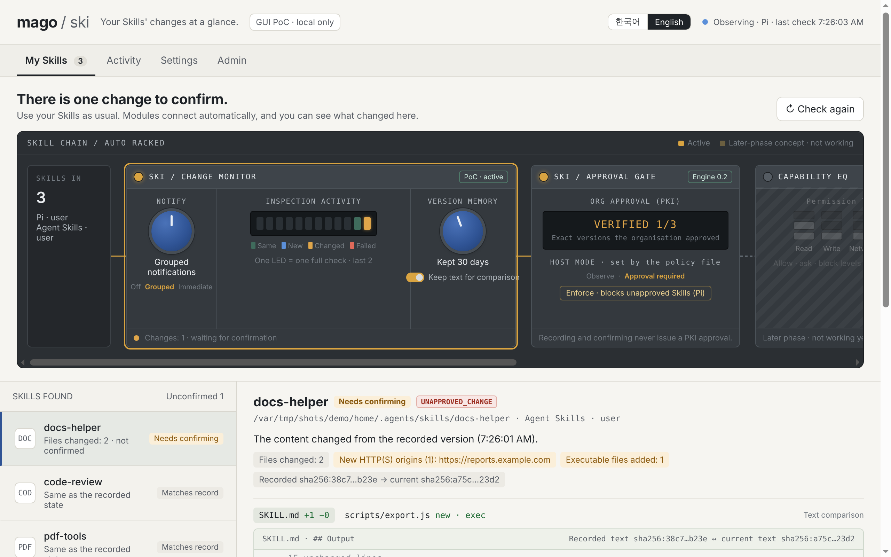
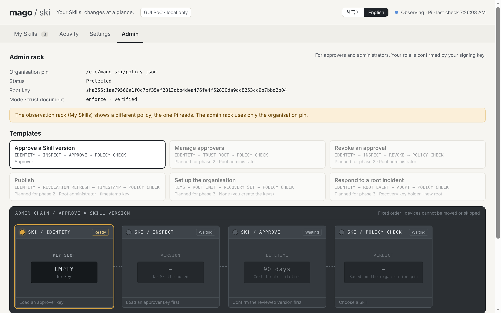
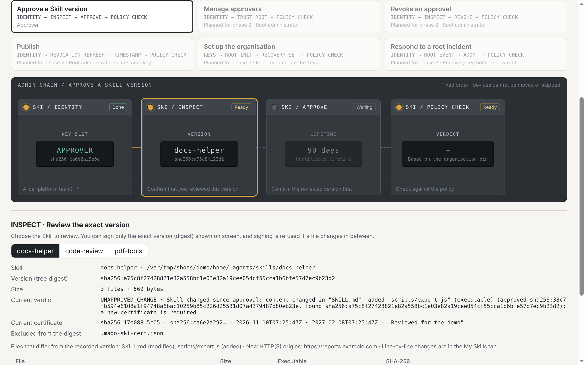

# mago-ski GUI (PoC)

A desktop companion that shows how your installed Skills change, next to whether your organization approved them. It runs as its own window, like a plug-in next to a DAW, and does not change how you install or use Skills.

> Status: **proof of concept**, not published. Linux and macOS. Pi is the only host it knows. The UI is in English or Korean.

The design comes from [the GUI product plan](../docs/mago-ski-gui-product-plan.md), [the ontology](../docs/mago-ski-ontology.md) §§18–27 and [the approved preview](../docs/mago-ski-gui-preview.html).

## Language

The header has a language switch, `한국어 | English`. It re-renders the page at once and keeps your place (tab, selection, typed text). The choice is stored in `settings.json` in the data folder (`{"lang":"ko"}` or `{"lang":"en"}`); without it the app uses the system language (Korean for a `ko` locale, English otherwise). Native dialogs, notifications and the admin session's messages follow the same language. All texts are in `src/i18n/messages.ts`; Korean texts quoted in this README and the spec are the Korean catalog entries.





Screenshots are made with `node scripts/screenshots.ts` (see the header of that script; the admin shots need the demo organisation's pin installed at `/etc/mago-ski`). Native dialogs are drawn by the OS and are not shown.

## What it does

- **Finds your Skills without setup.** It watches Pi's user Skill folder (`$PI_CODING_AGENT_DIR/skills`, default `~/.pi/agent/skills`) and `~/.agents/skills`, plus any folder you add. A folder with a `SKILL.md` is a Skill.
- **Remembers each version.** On first sight it records the Skill's tree digest (the engine's `mago.skill-tree/v2`, the same digest certificates sign) and keeps a copy of the files in its own data folder, never in the Skill folder.
- **Shows what changed.** When a Skill's digest changes, it shows the changed files, Markdown sections, executable bits and added or removed HTTP(S) origins (from the engine's `diffSkillTrees`), with a line diff of the text.
- **Lets you record what you did.** "변경 확인 완료" (change reviewed) either marks the change as reviewed or makes the new version your comparison baseline. Both record the digest whose change is on screen. If the Skill changes again, the old diff is taken down and the buttons stay disabled until the new diff is shown; if the files change between your click and the service's re-read, the action is refused.
- **Keeps earlier versions for a while.** Replaced baselines stay listed under "이전 버전" for the retention period set with the VERSION MEMORY knob (counted from when they were replaced), with their copies.
- **Says when its own history was lost.** If its history file is missing or unreadable, it says so, keeps the unreadable file aside, and shows every Skill as new rather than as unchanged, because changes made in between cannot be compared.
- **Lets approvers sign, in the administration rack (관리 tab).** The organisation is read only from the admin-owned pin `/etc/mago-ski/policy.json` (the file and every folder above it root-owned and not group- or other-writable). The *Skill 버전 승인* (Approve a Skill version) template is a fixed chain: IDENTITY (load your approver key; the app proves you hold it by signing a challenge and checking it against the organisation's documents) → INSPECT (the exact version: digest, every file, the certificate it carries; you confirm you reviewed it) → APPROVE (lifetime and reason; signs `approve --expect-digest` for that digest only) → POLICY CHECK (the verdict under the pin). The *Manage approvers* template (phase 2a: IDENTITY with the root key → TRUST ROOT → POLICY CHECK) adds, replaces, removes and renews approvers: the effect on every Skill folder is computed with the hosts' own loader and shown in a native signing dialog before anything is written. The other templates (revoke, refresh revocation list, sign timestamp, organisation setup, root incident) are shown and come in later phases. See [the administration rack spec](../docs/spec/gui-admin-rack-v1.md).
- **Shows organization approval as it is.** If Pi has a mago-ski policy (`$MAGO_SKI_POLICY` or `~/.mago-ski/policy.json`), each Skill shows the engine's verdict (`VERIFIED`, `UNAPPROVED_CHANGE`, `NO_CERTIFICATE`, …), the policy mode and the host's recent decisions. For approvers, it shows a `mago-ski approve … --expect-digest` command pinned to the version on screen.

## What it does not do

- **Observation never approves.** Recording, reviewing and remembering are local history. They do not create, change or imply a certificate, and they never change a PKI verdict. Only signing with an approver key does that, in the CLI or in the administration rack. A key loaded there stays in the main process's memory: never written, logged or shown to the window, dropped after 15 minutes idle, on a template change, when the pin changes and on quit, and its role is re-checked before every signature. Signing needs two native dialogs that only you can answer: one for the exact version you reviewed, one that shows everything that is signed. A pin change or a lost role drops the key within about 5 seconds. The app keeps its own memory of the newest organisation documents it has seen (`admin-state.json` in its data folder) and refuses older ones; the 관리 tab offers 기록 초기화 if an organisation was legitimately re-created. The administration rack is not supported in Flatpak, rootless containers or other user namespaces; on NixOS install the pin as a real file, not a link into the store.
- **It does not enforce.** In observation it never blocks a Skill. Blocking happens only in Pi with an `enforce` policy. Pi reads the policy when a session starts, so policy changes apply from the next session.
- **It does not judge safety.** Origin detection is partial (HTTP(S) origins in text files). A change with no new origin is still a change, and "기록과 같음" (same as recorded) means unchanged, not safe.
- **It does not write host files.** The policy, trust root, revocations and Pi's host state file are read only; Skill folders are read only too, except that APPROVE writes the certificate (`.mago-ski-cert.json`, which the digest excludes, or into the pin's first `certificate_dirs` entry), as `mago-ski approve` does. Trust is loaded with `recordVersions: false`, so the GUI never moves Pi's rollback memory.
- **It stops when closed.** Closing the window stops observation; the next start re-checks everything and reports changes made in between.
- The CAPABILITY EQ, DYNAMICS LIMITER and CLEAR FILTER modules in the rack are later stages. They are drawn dimmed and do nothing.

## Run it

Requires Node.js 22.23.4, 24.22.1 or 26.12.1 or newer in its line (the October 2026 security releases). The app itself runs on the Node.js bundled with Electron 45.1.0 (24.22.1).

```bash
cd gui
npm ci
npm start                       # builds, then opens the window
```

To try it without touching your own Skills, use a throwaway home directory:

```bash
node scripts/demo.ts setup /tmp/mago-demo --org      # three Skills; --org adds an enforce policy with two approved
HOME=/tmp/mago-demo/home MAGO_SKI_GUI_DATA=/tmp/mago-demo/gui-data npx electron .
node scripts/demo.ts change /tmp/mago-demo           # in another terminal: the preview's docs-helper change
```

On Linux as root, add `--no-sandbox` after `electron .`.

Data lives in Electron's user data folder (`~/.config/mago-ski` on Linux, `~/Library/Application Support/mago-ski` on macOS), or in `MAGO_SKI_GUI_DATA`: `state.json` and `blobs/` (file copies by SHA-256). Files over 4 MiB are not copied; such versions are compared by name, size and executable bit only, and the screen says so. Turn copying off with "비교용 원문 보관" (keep original text for comparison); that also deletes the copies already kept.

## Develop

```bash
npm ci --ignore-scripts         # skip the Electron download if you only run tests
npm run typecheck
npm test                        # service tests, no Electron needed
npm run build
xvfb-run -a node scripts/smoke.ts OUT_DIR   # drives the real app with Playwright and saves screenshots
```

Layout:

| Path | Role |
|---|---|
| `src/service/` | Observation service: discovery, versions, change view, PKI projection, digest-bound actions. Plain Node, reuses the engine in `../src` for every digest, diff and verification |
| `src/main/main.ts` | Electron main process: one window, IPC handlers with argument and sender checks, notifications |
| `src/preload/preload.cts` | Exposes exactly the `RendererApi` in `src/service/types.ts` |
| `src/renderer/` | The rack UI. Skill names, paths, file content and engine reasons are rendered as text only |

Security boundaries of the window: context isolation, sandboxed renderer, no Node integration, a CSP of `default-src 'none'; script-src 'self'; style-src 'self'`, navigation and new windows blocked, every permission request denied. The renderer never sends a path: folders are added through a native dialog owned by the main process.
